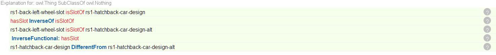
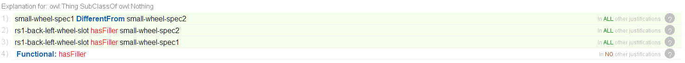
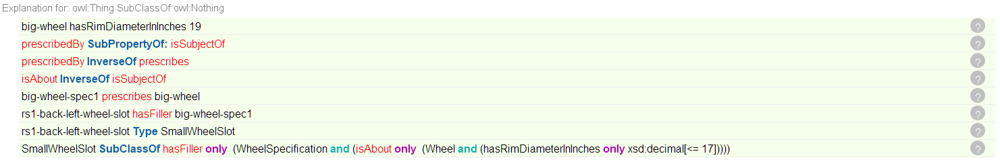
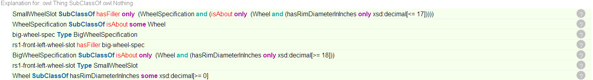

## Test-1

Wheel-slot-test1.rdf: Hatchback-car-design needs exactly 4 wheel slots, but only 3 slots are specified in the instance. 

CQ: Did rs1-hatchback-car-design requires the correct number of wheel specification? No

SHACL must fail!
```
@prefix sh:  <http://www.w3.org/ns/shacl#> .
@prefix ex:  <https://example.org/wheel-slot/> .
@prefix iof: <https://spec.industrialontologies.org/ontology/construct/> .

ex:CarWheelSlotShape
    a sh:NodeShape ;

    sh:targetNode ex:rs1-hatchback-car-design ;
    sh:targetClass
        <https://example.org/wheel-slot//Hatchback-car-design> ;

    sh:property [
        sh:path [ sh:inversePath iof:isSlotOf ] ;

        sh:qualifiedValueShape [
            sh:class ex:SmallWheelSlot
        ] ;

        sh:qualifiedMinCount 4 ;
        sh:qualifiedMaxCount 4 ;

        sh:message
            "The car design must explicitly own exactly four small-wheel slots."@en
    ] .
```

## Test-2

Wheel-slot-test2.rdf: one wheel slot is unfilled.

CQ: How many wheels are specified for the rs1-hatchback-car-design? 3

```
PREFIX ex:  <https://example.org/wheel-slot/>
PREFIX iof: <https://spec.industrialontologies.org/ontology/construct/>

SELECT (COUNT(DISTINCT ?slot) AS ?filledWheelSlots)
WHERE {
  GRAPH <https://example.org/wheel-slot/test2> {
    ?slot a ex:SmallWheelSlot ;
          iof:isSlotOf ex:rs1-hatchback-car-design ;
          iof:hasFiller ?wheelSpec .
  }
}
```

CQ: Which wheel is not specified? front right

Query returns `ex:/rs1-front-right-wheel-slot`

```
PREFIX ex:  <https://example.org/wheel-slot/>
PREFIX iof: <https://spec.industrialontologies.org/ontology/construct/>

SELECT DISTINCT ?slot
WHERE {
  GRAPH <https://example.org/wheel-slot/test2> {
    ?slot a ex:SmallWheelSlot ;
          iof:isSlotOf ex:rs1-hatchback-car-design .

    FILTER NOT EXISTS {
      ?slot iof:hasFiller ?filler .
    }
  }
}
```

## Test-3

Wheel-slot-test3.rdf: one slot is owned by two distinct owners.

CQ: Can two distinct hatchback design specifications share the same back left wheel slot? No 

reasoner will fail for the following reason:



## Test-4

Wheel-slot-test4.rdf: one slot is filled by two distinct fillers.

CQ: Can the hatchback design have two distinct wheel specification for back left wheel? No

reasoner will fail for the following reason:



## Test-5

Wheel-slot-test5.rdf: back left slot is filled by big wheel specification

CQ: Can a wheel specification prescribing a 19-inch rim fill a hatchback design’s wheel slot that permits rim diameters no greater than 17 inches? No

reasoner will fail for the following reason:



## Test-6

Wheel-slot-test6.rdf: The front-left wheel slot is filled by a big-wheel specification requiring rim diameters of at least 18 inches, without asserting a particular wheel or diameter value.

CQ: Can a wheel specification requiring rim diameters of at least 18 inches fill a hatchback design’s wheel slot that permits rim diameters no greater than 17 inches? No

reasoner will fail for the following reason:



## Test-7

wheel_slot_test7.rdf: Wheel slots belonging to the hatchback and hatchback-mini designs share small-wheel-spec1 as their filler.

CQ: Which hatchback designs share the same wheel specification small-wheel-spec1?

Expected answer: rs1-hatchback-car-design and rs1-hatchback-mini-car-design share small-wheel-spec1.

```
PREFIX ex:  <https://example.org/wheel-slot/>
PREFIX iof: <https://spec.industrialontologies.org/ontology/construct/>

SELECT DISTINCT ?design
WHERE {
GRAPH <https://example.org/wheel-slot/test7> {
  ?slot iof:hasFiller ex:small-wheel-spec1 ;
        iof:isSlotOf ?design .
    }
}
```

