# Machine Learning Lifecycle

_IOF-style scenario draft for the Machine Learning Lifecycle Ontology (MLLO)._

**Created by:** TBD  
**Modified by:** TBD  
**Reference format:** `IOF_Core_Pattern_v2.pdf`

## Scenario Objective

This scenario demonstrates how to represent a machine learning lifecycle using the IOF Machine Learning Lifecycle Ontology (MLLO). The scenario covers the main process chain from raw data through data preparation, data set partitioning, training, model execution, evaluation, deployment, production execution, monitoring, and possible model update.

The purpose of the pattern is to make lifecycle evidence explicit. A model should not only be described as "trained" or "deployed"; it should be connected to the process that trained it, the data set used for that training, the evaluation process that assessed it, the deployment process that placed it in an engineered system, and the monitoring processes that justify continued use or update.

## Key Points

- MLLO represents lifecycle stages as typed processes and typed information artifacts.
- `iof-constr:MachineLearningDataPreparationPipeline` converts a `iof-constr:RawDataSet` into a `iof-constr:MachineLearningDataSet`.
- `iof-constr:MachineLearningDataSetPartitioning` creates `iof-constr:TrainingDataSet` and evaluation data sets.
- `iof-constr:MachineLearningTraining` executes an encoded training algorithm to generate or update a `iof-constr:MachineLearningModel`.
- `iof-constr:ModelExecution` produces model outputs; `iof-constr:ModelEvaluation` assesses model outputs.
- `iof-constr:MachineLearningModelDeploymentProcess` relates the model to the engineered system in which it is deployed.
- `iof-constr:DataQualityMonitoring` and `iof-constr:ModelPerformanceMonitoring` represent production lifecycle evidence, not informal metadata.

## General Pattern Description

The general MLLO lifecycle pattern is process-centric. Each lifecycle stage is represented as an individual process with typed inputs and outputs. Data artifacts are connected using `iof-constr:hasDataInput` and `iof-constr:hasDataOutput`. Models, engineered systems, and other non-data continuants are connected with broader IOF/BFO relations such as `iof-constr:hasInput`, `iof-constr:hasOutput`, `iof-constr:hasSpecifiedOutput`, and BFO participant relations.

```mermaid
flowchart LR
    accTitle: MLLO lifecycle general pattern
    accDescr: General MLLO pattern showing how raw data is prepared, partitioned, used for training and evaluation, deployed into an engineered system, executed in production, and monitored

    raw_data[(RawDataSet)] --> prep[MachineLearningDataPreparationPipeline]
    prep --> ml_data[(MachineLearningDataSet)]
    ml_data --> partition[MachineLearningDataSetPartitioning]
    partition --> training_data[(TrainingDataSet)]
    partition --> evaluation_data[(ValidationDataSet or TestDataSet)]
    training_data --> training[MachineLearningTraining]
    training --> model[(MachineLearningModel)]
    model --> execution[ModelExecution]
    evaluation_data --> execution
    execution --> model_outputs[(ModelOutputDataSet)]
    model_outputs --> evaluation[ModelEvaluation]
    evaluation --> deployment[MachineLearningModelDeploymentProcess]
    deployment --> deployed_state[DeployedMachineLearningModelState]
    deployed_state --> production_execution[ModelExecution]
    production_execution --> production_outputs[(ModelOutputDataSet)]
    deployed_state --> data_monitoring[DataQualityMonitoring]
    deployed_state --> performance_monitoring[ModelPerformanceMonitoring]
    performance_monitoring --> update[MachineLearningModelUpdate]
    update --> model

    classDef data fill:#f3f4f6,stroke:#6b7280,stroke-width:2px,color:#1f2937
    classDef process fill:#dbeafe,stroke:#2563eb,stroke-width:2px,color:#1e3a5f
    classDef state fill:#ede9fe,stroke:#7c3aed,stroke-width:2px,color:#3b0764

    class raw_data,ml_data,training_data,evaluation_data,model,model_outputs,production_outputs data
    class prep,partition,training,execution,evaluation,deployment,production_execution,data_monitoring,performance_monitoring,update process
    class deployed_state state
```



The following table gives the minimum terms needed for the pattern.

| Construct | Pattern role |
| --------- | ------------ |
| `iof-constr:RawDataSet` | Data set collected from a domain of interest before processing |
| `iof-constr:MachineLearningDataPreparationPipeline` | Planned process converting a raw data set into a machine learning data set |
| `iof-constr:MachineLearningDataSet` | Data set composed of feature vectors for training or model execution |
| `iof-constr:Feature` | Data item intended as input to machine learning training or model execution |
| `iof-constr:FeatureVector` | Data set of features belonging to a single entity |
| `iof-constr:MachineLearningDataSetPartitioning` | Planned process that splits data for training and model evaluation |
| `iof-constr:TrainingDataSet` | Machine learning data set used as input to machine learning training |
| `iof-constr:ValidationDataSet` | Machine learning data set used for evaluation during hyperparameter tuning |
| `iof-constr:TestDataSet` | Machine learning data set used for final model evaluation |
| `iof-constr:MachineLearningTraining` | Computing process that executes an encoded training algorithm to generate or update a model |
| `iof-constr:MachineLearningModel` | Encoded algorithm executed to find patterns, make decisions, or make predictions |
| `iof-constr:ModelExecution` | Computing process in which a model is executed on a data set or feature vector |
| `iof-constr:ModelOutputDataSet` | Data set composed of model outputs |
| `iof-constr:ModelEvaluation` | Performance assessment using model output derived from an independent data set |
| `iof-constr:ModelValidation` | Iterative process of partitioning, training, and evaluation |
| `iof-constr:MachineLearningModelDeploymentProcess` | Planned process in which a model is deployed in an engineered system |
| `iof-constr:DeployedMachineLearningModelState` | Process during which a model is deployed on a particular engineered system |
| `iof-constr:DataQualityMonitoring` | Planned process assessing data quality before data is used by a deployed model |
| `iof-constr:ModelPerformanceMonitoring` | Planned process assessing performance of a deployed model |
| `iof-constr:MachineLearningModelUpdate` | Training process in which parameters of a previously trained model are updated |

## Use Case: Drill failure prediction lifecycle

A predictive maintenance team develops a machine learning model to predict whether an industrial drill will fail. The available data contains measured values such as tool wear, air temperature, process temperature, torque, and rotational speed. The target variable indicates whether the drill failed.

The team prepares the raw data, partitions it into training, validation, and test data sets, trains a candidate model, evaluates model outputs derived from independent validation or test data, deploys the accepted model into an engineered production system, executes the model on production feature vectors, and monitors both data quality and model performance.

## Use-Case Pattern Description

The use case applies the general pattern as follows.

| Use-case entity | MLLO class |
| --------------- | ---------- |
| `:drill_failure_raw_dataset_001` | `iof-constr:RawDataSet` |
| `:drill_failure_preparation_001` | `iof-constr:MachineLearningDataPreparationPipeline` |
| `:drill_failure_ml_dataset_001` | `iof-constr:MachineLearningDataSet` |
| `:drill_failure_partitioning_001` | `iof-constr:MachineLearningDataSetPartitioning` |
| `:drill_failure_training_dataset_001` | `iof-constr:TrainingDataSet` |
| `:drill_failure_validation_dataset_001` | `iof-constr:ValidationDataSet` |
| `:drill_failure_test_dataset_001` | `iof-constr:TestDataSet` |
| `:drill_failure_training_001` | `iof-constr:MachineLearningTraining` |
| `:drill_failure_model_001` | `iof-constr:MachineLearningModel` |
| `:drill_failure_validation_execution_001` | `iof-constr:ModelExecution` |
| `:drill_failure_evaluation_001` | `iof-constr:ModelEvaluation` |
| `:drill_failure_deployment_001` | `iof-constr:MachineLearningModelDeploymentProcess` |
| `:drill_failure_deployed_state_001` | `iof-constr:DeployedMachineLearningModelState` |
| `:drill_failure_data_quality_monitoring_001` | `iof-constr:DataQualityMonitoring` |
| `:drill_failure_performance_monitoring_001` | `iof-constr:ModelPerformanceMonitoring` |

```mermaid
flowchart LR
    accTitle: Drill failure lifecycle use case
    accDescr: Object-level MLLO use case showing drill failure data flowing through preparation, partitioning, training, evaluation, deployment, production execution, and monitoring

    raw[(drill_failure_raw_dataset_001)] --> prep[drill_failure_preparation_001]
    prep --> ml[(drill_failure_ml_dataset_001)]
    ml --> split[drill_failure_partitioning_001]
    split --> train[(drill_failure_training_dataset_001)]
    split --> valid[(drill_failure_validation_dataset_001)]
    train --> train_run[drill_failure_training_001]
    train_run --> model[(drill_failure_model_001)]
    model --> val_exec[drill_failure_validation_execution_001]
    valid --> val_exec
    val_exec --> val_outputs[(drill_failure_validation_outputs_001)]
    val_outputs --> eval[drill_failure_evaluation_001]
    eval --> perf[(drill_failure_performance_result_001)]
    model --> deploy[drill_failure_deployment_001]
    deploy --> state[drill_failure_deployed_state_001]
    state --> prod_exec[drill_failure_production_execution_001]
    prod_exec --> prod_outputs[(drill_failure_production_outputs_001)]
    state --> dq[drill_failure_data_quality_monitoring_001]
    state --> pm[drill_failure_performance_monitoring_001]

    classDef data fill:#f3f4f6,stroke:#6b7280,stroke-width:2px,color:#1f2937
    classDef process fill:#dbeafe,stroke:#2563eb,stroke-width:2px,color:#1e3a5f
    classDef result fill:#dcfce7,stroke:#16a34a,stroke-width:2px,color:#14532d

    class raw,ml,train,valid,model,val_outputs,prod_outputs data
    class prep,split,train_run,val_exec,eval,deploy,state,prod_exec,dq,pm process
    class perf result
```



The training process has the training data set as a data input, executes an encoded training algorithm, and has the trained model as its specified output. The validation execution uses the model on validation data and produces a model output data set. The evaluation process assesses that model output data set and produces a performance result. The deployment process uses the model and involves an engineered system. The deployed model state meets the deployment process and has the model and engineered system as participants.

## Use-Case Example Data

The example data can be represented as a small tabular data set before RDF mapping. The following records are sufficient to demonstrate the pattern.

| record_id | tool_wear_min | air_temperature_k | process_temperature_k | torque_nm | rotational_speed_rpm | target_failure |
| --------- | ------------- | ----------------- | --------------------- | --------- | -------------------- | -------------- |
| row_001 | 0 | 298.1 | 308.6 | 42.8 | 1551 | false |
| row_002 | 3 | 298.2 | 308.7 | 46.3 | 1408 | false |
| row_003 | 5 | 298.1 | 308.5 | 49.4 | 1498 | false |

Each row corresponds to one feature vector for a drill observation. The measured columns become features or values associated with features. The `target_failure` column corresponds to the target variable used for supervised learning and evaluation.

## Lifecycle Stage Capture Patterns

The lifecycle should be captured as a chain of smaller patterns rather than as one large monolithic graph. Each stage pattern below can be used independently, but the output of one stage should become the input or evidence for the next stage whenever the lifecycle is known.

The diagrams in this section use NOWL PlantUML notation from `/Users/pnc12/Documents/GitHub/nowl`. In the diagrams, `mllo:` is used as a compact visual prefix for MLLO construct terms that are written as `iof-constr:` in the RDF examples and tables.

### Pattern 1: Objective and requirements capture

**Intent:** Capture what the model is supposed to do before any data processing or training is represented.

Class diagram:

```plantuml
@startuml
!include /Users/pnc12/Documents/GitHub/nowl/nowl/nowl.iuml
left to right direction
class(c1, mllo:ClassificationObjective)
class(c2, mllo:ModelInputRequirementSpecification)
class(c3, mllo:TargetVariable)
class(c4, mllo:PerformanceMetric)
class(c5, mllo:ModelAssumptions)
class(c6, mllo:MachineLearningTraining)
class(c7, mllo:ModelEvaluation)
xSome(c1, iof:hasInput, c2, "", right)
xSome(c2, iof:hasSpecifiedOutput, c3, "", right)
xSome(c1, iof:hasInput, c5, "", down)
xSome(c7, iof:concretizes, c4, "", right)
xSome(c6, iof:hasInput, c2, "", down)
@enduml
```

Object diagram:

```plantuml
@startuml
!include /Users/pnc12/Documents/GitHub/nowl/nowl/nowl.iuml
left to right direction
class(c1, mllo:ClassificationObjective)
class(c2, mllo:ModelInputRequirementSpecification)
class(c3, mllo:TargetVariable)
class(c4, mllo:PerformanceMetric)
class(c5, mllo:ModelAssumptions)
individual(o1, ns1:drill_failure_objective_001)
individual(o2, ns1:drill_failure_input_requirements_001)
individual(o3, ns1:drill_failure_target_variable_001)
individual(o4, ns1:drill_failure_accuracy_metric_001)
individual(o5, ns1:drill_failure_model_assumptions_001)
typeOf(o1, c1)
typeOf(o2, c2)
typeOf(o3, c3)
typeOf(o4, c4)
typeOf(o5, c5)
property(o1, iof:hasInput, o2, right)
property(o2, iof:hasSpecifiedOutput, o3, right)
property(o1, iof:hasInput, o5, down)
@enduml
```

| Pattern element | Recommended MLLO construct |
| --------------- | -------------------------- |
| Prediction, classification, regression, or action-selection goal | `iof-constr:PredictionObjective`, `iof-constr:ClassificationObjective`, `iof-constr:RegressionObjective`, or `iof-constr:ActionSelectionObjective` |
| Input requirements | `iof-constr:ModelInputRequirementSpecification` |
| General requirements | `iof-constr:RequirementSpecification` |
| Target variable | `iof-constr:TargetVariable` |
| Performance metric | `iof-constr:PerformanceMetric` |
| Model assumptions | `iof-constr:ModelAssumptions` |

Capture this stage when the project defines the business or engineering purpose of the model. For the drill-failure use case, the objective is a classification objective: predict `failure` or `not failure` for a drill observation. The input requirements prescribe which measured values must be available, such as tool wear, air temperature, process temperature, torque, and rotational speed. The target variable is the failure indicator.

| Subject | Predicate | Object |
| ------- | --------- | ------ |
| `:drill_failure_objective_001` | `rdf:type` | `iof-constr:ClassificationObjective` |
| `:drill_failure_input_requirements_001` | `rdf:type` | `iof-constr:ModelInputRequirementSpecification` |
| `:drill_failure_target_variable_001` | `rdf:type` | `iof-constr:TargetVariable` |
| `:drill_failure_accuracy_metric_001` | `rdf:type` | `iof-constr:PerformanceMetric` |
| `:drill_failure_model_assumptions_001` | `rdf:type` | `iof-constr:ModelAssumptions` |

**Use-case note:** In an application profile, connect these artifacts to the training, evaluation, and selection processes. MLLO provides the objective and requirement constructs; the exact project governance relation for approval or acceptance may need to be specialized locally.

### Pattern 2: Raw data capture

**Intent:** Capture the source data set before cleaning, processing, or feature construction.

Class diagram:

```plantuml
@startuml
!include /Users/pnc12/Documents/GitHub/nowl/nowl/nowl.iuml
left to right direction
class(c1, mllo:RawDataSet)
class(c2, mllo:FeatureVector)
class(c3, mllo:NumericalFeature)
class(c4, mllo:TargetVariable)
class(c5, mllo:MachineLearningDataPreparationPipeline)
xSome(c1, bfo:BFO_0000115, c2, "", right)
xSome(c2, bfo:BFO_0000115, c3, "", right)
xSome(c2, mllo:hasTargetVariable, c4, "", down)
xSome(c5, mllo:hasDataInput, c1, "", down)
@enduml
```

Object diagram:

```plantuml
@startuml
!include /Users/pnc12/Documents/GitHub/nowl/nowl/nowl.iuml
left to right direction
class(c1, mllo:RawDataSet)
class(c2, mllo:FeatureVector)
class(c3, mllo:NumericalFeature)
class(c4, mllo:TargetVariable)
individual(o1, ns1:drill_failure_raw_dataset_001)
individual(o2, ns1:drill_observation_vector_001)
individual(o3, ns1:tool_wear_feature_001)
individual(o4, ns1:failure_target_001)
typeOf(o1, c1)
typeOf(o2, c2)
typeOf(o3, c3)
typeOf(o4, c4)
property(o1, bfo:BFO_0000115, o2, right)
property(o2, bfo:BFO_0000115, o3, right)
property(o2, mllo:hasTargetVariable, o4, down)
@enduml
```

| Pattern element | Recommended MLLO construct |
| --------------- | -------------------------- |
| Source data set | `iof-constr:RawDataSet` |
| Individual row or observation | `iof-constr:FeatureVector` when the row is treated as model input |
| Input attribute | `iof-constr:Feature` or a subtype such as `iof-constr:NumericalFeature`, `iof-constr:CategoricalFeature`, or `iof-constr:DateTimeFeature` |
| Target variable | `iof-constr:TargetVariable` |

For the drill-failure use case, the raw data set is the table collected from maintenance or process records. Each row can later become a feature vector. Each measured column can be represented as a feature, and the failure column can be represented as the target variable.

| Subject | Predicate | Object |
| ------- | --------- | ------ |
| `:drill_failure_raw_dataset_001` | `rdf:type` | `iof-constr:RawDataSet` |
| `:drill_observation_vector_001` | `rdf:type` | `iof-constr:FeatureVector` |
| `:tool_wear_feature_001` | `rdf:type` | `iof-constr:NumericalFeature` |
| `:failure_target_001` | `rdf:type` | `iof-constr:TargetVariable` |
| `:drill_observation_vector_001` | `iof-constr:hasTargetVariable` | `:failure_target_001` |

**Use-case note:** Keep raw data separate from prepared data. Raw data is the evidence of what was available before cleaning, imputation, encoding, scaling, or partitioning.

### Pattern 3: Exploratory data analysis

**Intent:** Capture data understanding activities and their outputs before data preparation decisions are made.

Class diagram:

```plantuml
@startuml
!include /Users/pnc12/Documents/GitHub/nowl/nowl/nowl.iuml
left to right direction
class(c1, mllo:ExploratoryDataAnalysis)
class(c2, mllo:DataSet)
class(c3, mllo:DataSetCharacteristic)
class(c4, mllo:DataItemCharacteristic)
class(c5, mllo:MachineLearningDataPreparationPipeline)
class(c6, mllo:FeatureEngineeringPipeline)
xSome(c1, mllo:hasDataInput, c2, "", left)
xSome(c1, mllo:hasSpecifiedOutput, c3, "", right)
xSome(c1, mllo:hasSpecifiedOutput, c4, "", right)
xSome(c5, iof:hasInput, c3, "", down)
xSome(c6, iof:hasInput, c4, "", down)
@enduml
```

Object diagram:

```plantuml
@startuml
!include /Users/pnc12/Documents/GitHub/nowl/nowl/nowl.iuml
left to right direction
class(c1, mllo:ExploratoryDataAnalysis)
class(c2, mllo:RawDataSet)
class(c3, mllo:DataSetCharacteristic)
individual(o1, ns1:drill_failure_eda_001)
individual(o2, ns1:drill_failure_raw_dataset_001)
individual(o3, ns1:class_imbalance_characteristic_001)
typeOf(o1, c1)
typeOf(o2, c2)
typeOf(o3, c3)
property(o1, mllo:hasDataInput, o2, left)
property(o1, iof:hasSpecifiedOutput, o3, right)
@enduml
```

| Pattern element | Recommended MLLO construct |
| --------------- | -------------------------- |
| EDA process | `iof-constr:ExploratoryDataAnalysis` |
| Data input | `iof-constr:DataSet` or `iof-constr:RawDataSet` |
| Data set characteristic | `iof-constr:DataSetCharacteristic` |
| Data item characteristic | `iof-constr:DataItemCharacteristic` |
| Data description objective | `iof-constr:DataDescriptionObjective` |

For the drill-failure use case, EDA can determine missingness in `tool_wear_min`, skew in `torque_nm`, correlation between temperature columns, or class imbalance in the failure target.

| Subject | Predicate | Object |
| ------- | --------- | ------ |
| `:drill_failure_eda_001` | `rdf:type` | `iof-constr:ExploratoryDataAnalysis` |
| `:drill_failure_eda_001` | `iof-constr:hasDataInput` | `:drill_failure_raw_dataset_001` |
| `:drill_failure_eda_001` | `iof-constr:hasSpecifiedOutput` | `:class_imbalance_characteristic_001` |
| `:class_imbalance_characteristic_001` | `rdf:type` | `iof-constr:DataSetCharacteristic` |

**Use-case note:** EDA outputs justify later choices. For example, observed missingness justifies imputation; observed skew may justify scaling or transformation; observed class imbalance may justify metric choice or sampling strategy.

### Pattern 4: Data preparation

**Intent:** Capture the planned process that transforms raw data into a machine learning data set.

Class diagram:

```plantuml
@startuml
!include /Users/pnc12/Documents/GitHub/nowl/nowl/nowl.iuml
left to right direction
class(c1, mllo:MachineLearningDataPreparationPipeline)
class(c2, mllo:RawDataSet)
class(c3, mllo:MachineLearningDataSet)
class(c4, mllo:DataCleaningOperation)
class(c5, mllo:DataImputationOperation)
class(c6, mllo:DataReshapingOperation)
xSome(c1, mllo:hasDataInput, c2, "", left)
xSome(c1, mllo:hasDataOutput, c3, "", right)
xSome(c1, bfo:BFO_0000117, c4, "", down)
xSome(c1, bfo:BFO_0000117, c5, "", down)
xSome(c1, bfo:BFO_0000117, c6, "", down)
@enduml
```

Object diagram:

```plantuml
@startuml
!include /Users/pnc12/Documents/GitHub/nowl/nowl/nowl.iuml
left to right direction
class(c1, mllo:MachineLearningDataPreparationPipeline)
class(c2, mllo:RawDataSet)
class(c3, mllo:MachineLearningDataSet)
individual(o1, ns1:drill_failure_preparation_001)
individual(o2, ns1:drill_failure_raw_dataset_001)
individual(o3, ns1:drill_failure_ml_dataset_001)
typeOf(o1, c1)
typeOf(o2, c2)
typeOf(o3, c3)
property(o1, mllo:hasDataInput, o2, left)
property(o1, mllo:hasDataOutput, o3, right)
@enduml
```

| Pattern element | Recommended MLLO construct |
| --------------- | -------------------------- |
| Preparation pipeline | `iof-constr:MachineLearningDataPreparationPipeline` |
| Raw input | `iof-constr:RawDataSet` |
| Prepared output | `iof-constr:MachineLearningDataSet` or `iof-constr:PreProcessedDataSet` |
| Data cleaning pipeline | `iof-constr:DataCleaningPipeline` |
| Data cleaning operation | `iof-constr:DataCleaningOperation` |
| Data imputation operation | `iof-constr:DataImputationOperation` |
| Data reshaping operation | `iof-constr:DataReshapingOperation` |

For the drill-failure use case, this stage converts raw maintenance records into a model-ready data set. Typical operations include removing invalid rows, imputing missing temperatures, normalizing units, encoding categorical values, and preserving the target variable.

| Subject | Predicate | Object |
| ------- | --------- | ------ |
| `:drill_failure_preparation_001` | `rdf:type` | `iof-constr:MachineLearningDataPreparationPipeline` |
| `:drill_failure_preparation_001` | `iof-constr:hasDataInput` | `:drill_failure_raw_dataset_001` |
| `:drill_failure_preparation_001` | `iof-constr:hasDataOutput` | `:drill_failure_ml_dataset_001` |
| `:drill_failure_ml_dataset_001` | `rdf:type` | `iof-constr:MachineLearningDataSet` |

**Use-case note:** The preparation pipeline is the lifecycle anchor for data lineage. If the prepared data set is later used for training, evaluation, or production execution, trace it back to this preparation stage.

### Pattern 5: Feature engineering

**Intent:** Capture construction, transformation, scaling, or selection of features used by training and execution.

Class diagram:

```plantuml
@startuml
!include /Users/pnc12/Documents/GitHub/nowl/nowl/nowl.iuml
left to right direction
class(c1, mllo:FeatureEngineeringPipeline)
class(c2, mllo:MachineLearningDataSet)
class(c3, mllo:MachineLearningDataSet)
class(c4, mllo:FeatureEngineeringOperation)
class(c5, mllo:FeatureScalingOperation)
class(c6, mllo:FeatureSelection)
class(c7, mllo:DerivedFeature)
class(c8, mllo:ScaledFeature)
xSome(c1, mllo:hasDataInput, c2, "", left)
xSome(c1, mllo:hasDataOutput, c3, "", right)
xSome(c1, bfo:BFO_0000117, c4, "", down)
xSome(c1, bfo:BFO_0000117, c5, "", down)
xSome(c1, bfo:BFO_0000117, c6, "", down)
xSome(c4, mllo:hasDataOutput, c7, "", right)
xSome(c5, mllo:hasDataOutput, c8, "", right)
@enduml
```

Object diagram:

```plantuml
@startuml
!include /Users/pnc12/Documents/GitHub/nowl/nowl/nowl.iuml
left to right direction
class(c1, mllo:FeatureEngineeringPipeline)
class(c2, mllo:MachineLearningDataSet)
class(c3, mllo:MachineLearningDataSet)
class(c4, mllo:DerivedFeature)
class(c5, mllo:ScaledFeature)
individual(o1, ns1:drill_failure_feature_engineering_001)
individual(o2, ns1:drill_failure_ml_dataset_001)
individual(o3, ns1:drill_failure_feature_dataset_001)
individual(o4, ns1:temperature_delta_feature_001)
individual(o5, ns1:scaled_torque_feature_001)
typeOf(o1, c1)
typeOf(o2, c2)
typeOf(o3, c3)
typeOf(o4, c4)
typeOf(o5, c5)
property(o1, mllo:hasDataInput, o2, left)
property(o1, mllo:hasDataOutput, o3, right)
property(o3, bfo:BFO_0000115, o4, down)
property(o3, bfo:BFO_0000115, o5, down)
@enduml
```

| Pattern element | Recommended MLLO construct |
| --------------- | -------------------------- |
| Feature engineering pipeline | `iof-constr:FeatureEngineeringPipeline` |
| Feature engineering operation | `iof-constr:FeatureEngineeringOperation` |
| Encoded feature engineering algorithm | `iof-constr:EncodedFeatureEngineeringAlgorithm` |
| Feature engineering transformation | `iof-constr:FeatureEngineeringTransformation` |
| Feature scaling operation | `iof-constr:FeatureScalingOperation` |
| Feature selection | `iof-constr:FeatureSelection` |
| Derived feature | `iof-constr:DerivedFeature` |
| Scaled feature | `iof-constr:ScaledFeature` |

For the drill-failure use case, feature engineering may create a derived feature from temperature difference, scale torque and rotational speed, or select a subset of predictive features.

| Subject | Predicate | Object |
| ------- | --------- | ------ |
| `:drill_failure_feature_engineering_001` | `rdf:type` | `iof-constr:FeatureEngineeringPipeline` |
| `:drill_failure_feature_engineering_001` | `iof-constr:hasDataInput` | `:drill_failure_ml_dataset_001` |
| `:drill_failure_feature_engineering_001` | `iof-constr:hasDataOutput` | `:drill_failure_feature_dataset_001` |
| `:temperature_delta_feature_001` | `rdf:type` | `iof-constr:DerivedFeature` |
| `:scaled_torque_feature_001` | `rdf:type` | `iof-constr:ScaledFeature` |

**Use-case note:** Feature engineering may be part of the broader data preparation pipeline or represented as a separate subprocess when feature lineage matters.

### Pattern 6: Data partitioning

**Intent:** Capture how the machine learning data set is split into training and evaluation subsets.

Class diagram:

```plantuml
@startuml
!include /Users/pnc12/Documents/GitHub/nowl/nowl/nowl.iuml
left to right direction
class(c1, mllo:MachineLearningDataSetPartitioning)
class(c2, mllo:MachineLearningDataSet)
class(c3, mllo:TrainingDataSet)
class(c4, mllo:ValidationDataSet)
class(c5, mllo:TestDataSet)
class(c6, mllo:MachineLearningTraining)
class(c7, mllo:ModelEvaluation)
xSome(c1, mllo:hasDataInput, c2, "", left)
xSome(c1, mllo:hasDataOutput, c3, "", right)
xSome(c1, mllo:hasDataOutput, c4, "", right)
xSome(c1, mllo:hasDataOutput, c5, "", right)
xSome(c6, mllo:hasDataInput, c3, "", down)
xSome(c7, mllo:hasDataInput, c4, "", down)
xSome(c7, mllo:hasDataInput, c5, "", down)
@enduml
```

Object diagram:

```plantuml
@startuml
!include /Users/pnc12/Documents/GitHub/nowl/nowl/nowl.iuml
left to right direction
class(c1, mllo:MachineLearningDataSetPartitioning)
class(c2, mllo:MachineLearningDataSet)
class(c3, mllo:TrainingDataSet)
class(c4, mllo:ValidationDataSet)
class(c5, mllo:TestDataSet)
individual(o1, ns1:drill_failure_partitioning_001)
individual(o2, ns1:drill_failure_feature_dataset_001)
individual(o3, ns1:drill_failure_training_dataset_001)
individual(o4, ns1:drill_failure_validation_dataset_001)
individual(o5, ns1:drill_failure_test_dataset_001)
typeOf(o1, c1)
typeOf(o2, c2)
typeOf(o3, c3)
typeOf(o4, c4)
typeOf(o5, c5)
property(o1, mllo:hasDataInput, o2, left)
property(o1, mllo:hasDataOutput, o3, right)
property(o1, mllo:hasDataOutput, o4, right)
property(o1, mllo:hasDataOutput, o5, right)
@enduml
```

| Pattern element | Recommended MLLO construct |
| --------------- | -------------------------- |
| Partitioning process | `iof-constr:MachineLearningDataSetPartitioning` |
| Input data set | `iof-constr:MachineLearningDataSet` |
| Training output | `iof-constr:TrainingDataSet` |
| Tuning output | `iof-constr:ValidationDataSet` |
| Final evaluation output | `iof-constr:TestDataSet` |

For the drill-failure use case, this stage records that the model was trained on one subset and evaluated on independent validation or test data. This is important because MLLO defines model evaluation around outputs derived from an independent data set.

| Subject | Predicate | Object |
| ------- | --------- | ------ |
| `:drill_failure_partitioning_001` | `rdf:type` | `iof-constr:MachineLearningDataSetPartitioning` |
| `:drill_failure_partitioning_001` | `iof-constr:hasDataInput` | `:drill_failure_feature_dataset_001` |
| `:drill_failure_partitioning_001` | `iof-constr:hasDataOutput` | `:drill_failure_training_dataset_001` |
| `:drill_failure_partitioning_001` | `iof-constr:hasDataOutput` | `:drill_failure_validation_dataset_001` |
| `:drill_failure_partitioning_001` | `iof-constr:hasDataOutput` | `:drill_failure_test_dataset_001` |

**Use-case note:** If the split strategy matters, represent the split specification or algorithm as an application-specific information artifact or algorithm associated with the partitioning process.

### Pattern 7: Model development and training

**Intent:** Capture the process that executes a training algorithm and produces or updates a model.

Class diagram:

```plantuml
@startuml
!include /Users/pnc12/Documents/GitHub/nowl/nowl/nowl.iuml
left to right direction
class(c1, mllo:MachineLearningTraining)
class(c2, mllo:TrainingDataSet)
class(c3, mllo:EncodedMachineLearningTrainingAlgorithm)
class(c4, mllo:InitialMachineLearningParameterSettingSet)
class(c5, mllo:HyperparameterSet)
class(c6, mllo:MachineLearningParameterSettingSet)
class(c7, mllo:MachineLearningModel)
xSome(c1, mllo:hasDataInput, c2, "", left)
xSome(c1, mllo:executed, c3, "", left)
xSome(c1, iof:hasInput, c4, "", down)
xSome(c1, iof:hasInput, c5, "", down)
xSome(c1, iof:hasOutput, c6, "", right)
xSome(c1, iof:hasSpecifiedOutput, c7, "", right)
@enduml
```

Object diagram:

```plantuml
@startuml
!include /Users/pnc12/Documents/GitHub/nowl/nowl/nowl.iuml
left to right direction
class(c1, mllo:MachineLearningTraining)
class(c2, mllo:TrainingDataSet)
class(c3, mllo:EncodedMachineLearningTrainingAlgorithm)
class(c4, mllo:MachineLearningModel)
individual(o1, ns1:drill_failure_training_001)
individual(o2, ns1:drill_failure_training_dataset_001)
individual(o3, ns1:drill_failure_training_algorithm_001)
individual(o4, ns1:drill_failure_model_001)
typeOf(o1, c1)
typeOf(o2, c2)
typeOf(o3, c3)
typeOf(o4, c4)
property(o1, mllo:hasDataInput, o2, left)
property(o1, mllo:executed, o3, left)
property(o1, iof:hasSpecifiedOutput, o4, right)
@enduml
```

| Pattern element | Recommended MLLO construct |
| --------------- | -------------------------- |
| Training process | `iof-constr:MachineLearningTraining` |
| Training algorithm | `iof-constr:EncodedMachineLearningTrainingAlgorithm` |
| Initial parameter settings | `iof-constr:InitialMachineLearningParameterSettingSet` |
| Learned parameter settings | `iof-constr:MachineLearningParameterSettingSet` |
| Hyperparameters | `iof-constr:HyperparameterSet` |
| Trained model | `iof-constr:MachineLearningModel` |
| Model type | `iof-constr:ArtificialNeuralNetwork`, `iof-constr:DecisionTreeModel`, `iof-constr:LinearModel`, or another available model subtype |

For the drill-failure use case, training may execute a neural-network training algorithm or a decision-tree training algorithm on `:drill_failure_training_dataset_001`. The result is `:drill_failure_model_001`.

| Subject | Predicate | Object |
| ------- | --------- | ------ |
| `:drill_failure_training_001` | `rdf:type` | `iof-constr:MachineLearningTraining` |
| `:drill_failure_training_001` | `iof-constr:hasDataInput` | `:drill_failure_training_dataset_001` |
| `:drill_failure_training_001` | `iof-constr:executed` | `:drill_failure_training_algorithm_001` |
| `:drill_failure_training_001` | `iof-constr:hasSpecifiedOutput` | `:drill_failure_model_001` |
| `:drill_failure_model_001` | `rdf:type` | `iof-constr:MachineLearningModel` |

**Use-case note:** Use `MachineLearningModelUpdate` instead of a plain training process when the process updates parameters of a previously trained model.

### Pattern 8: Hyperparameter tuning and validation

**Intent:** Capture iterative training and evaluation used to tune candidate models.

Class diagram:

```plantuml
@startuml
!include /Users/pnc12/Documents/GitHub/nowl/nowl/nowl.iuml
left to right direction
class(c1, mllo:ModelValidation)
class(c2, mllo:MachineLearningDataSetPartitioning)
class(c3, mllo:HyperparameterTuning)
class(c4, mllo:HyperparameterSet)
class(c5, mllo:MachineLearningTraining)
class(c6, mllo:ModelExecution)
class(c7, mllo:ModelEvaluation)
class(c8, mllo:ModelPerformanceResult)
xSome(c1, bfo:BFO_0000117, c2, "", down)
xSome(c1, bfo:BFO_0000117, c5, "", down)
xSome(c1, bfo:BFO_0000117, c7, "", down)
xSome(c3, iof:hasOutput, c4, "", right)
xSome(c5, iof:hasInput, c4, "", right)
xSome(c7, iof:hasSpecifiedOutput, c8, "", right)
@enduml
```

Object diagram:

```plantuml
@startuml
!include /Users/pnc12/Documents/GitHub/nowl/nowl/nowl.iuml
left to right direction
class(c1, mllo:ModelValidation)
class(c2, mllo:MachineLearningDataSetPartitioning)
class(c3, mllo:MachineLearningTraining)
class(c4, mllo:ModelEvaluation)
class(c5, mllo:HyperparameterSet)
individual(o1, ns1:drill_failure_validation_001)
individual(o2, ns1:drill_failure_partitioning_001)
individual(o3, ns1:drill_failure_training_001)
individual(o4, ns1:drill_failure_evaluation_001)
individual(o5, ns1:drill_failure_hyperparameter_set_001)
typeOf(o1, c1)
typeOf(o2, c2)
typeOf(o3, c3)
typeOf(o4, c4)
typeOf(o5, c5)
property(o1, bfo:BFO_0000117, o2, down)
property(o1, bfo:BFO_0000117, o3, down)
property(o1, bfo:BFO_0000117, o4, down)
property(o3, iof:hasInput, o5, right)
@enduml
```

| Pattern element | Recommended MLLO construct |
| --------------- | -------------------------- |
| Validation process | `iof-constr:ModelValidation` |
| Hyperparameter tuning | `iof-constr:HyperparameterTuning` |
| Hyperparameter set | `iof-constr:HyperparameterSet` |
| Partitioning subprocess | `iof-constr:MachineLearningDataSetPartitioning` |
| Training subprocess | `iof-constr:MachineLearningTraining` |
| Evaluation subprocess | `iof-constr:ModelEvaluation` |
| Performance result | `iof-constr:ModelPerformanceResult` |

For the drill-failure use case, validation may compare several hyperparameter sets. Each iteration partitions data if needed, trains a model candidate, executes that model on validation data, and evaluates the output.

| Subject | Predicate | Object |
| ------- | --------- | ------ |
| `:drill_failure_validation_001` | `rdf:type` | `iof-constr:ModelValidation` |
| `:drill_failure_validation_001` | `bfo:BFO_0000117` | `:drill_failure_partitioning_001` |
| `:drill_failure_validation_001` | `bfo:BFO_0000117` | `:drill_failure_training_001` |
| `:drill_failure_validation_001` | `bfo:BFO_0000117` | `:drill_failure_evaluation_001` |
| `:drill_failure_hyperparameter_set_001` | `rdf:type` | `iof-constr:HyperparameterSet` |

**Use-case note:** MLLO defines `ModelValidation` as successive iterations of partitioning, training, and evaluation. Represent each important iteration when model selection or auditability requires it.

### Pattern 9: Model execution and evaluation

**Intent:** Separate the execution that produces model outputs from the evaluation that assesses those outputs.

Class diagram:

```plantuml
@startuml
!include /Users/pnc12/Documents/GitHub/nowl/nowl/nowl.iuml
left to right direction
class(c1, mllo:ModelExecution)
class(c2, mllo:ValidationDataSet)
class(c3, mllo:TestDataSet)
class(c4, mllo:MachineLearningModel)
class(c5, mllo:ModelOutputDataSet)
class(c6, mllo:ModelEvaluation)
class(c7, mllo:PerformanceMetric)
class(c8, mllo:ModelPerformanceResult)
xSome(c1, mllo:hasDataInput, c2, "", left)
xSome(c1, mllo:hasDataInput, c3, "", left)
xSome(c1, mllo:executed, c4, "", left)
xSome(c1, mllo:hasDataOutput, c5, "", right)
xSome(c6, mllo:hasDataInput, c5, "", left)
xSome(c6, mllo:concretizes, c7, "", down)
xSome(c6, iof:hasSpecifiedOutput, c8, "", right)
@enduml
```

Object diagram:

```plantuml
@startuml
!include /Users/pnc12/Documents/GitHub/nowl/nowl/nowl.iuml
left to right direction
class(c1, mllo:ModelExecution)
class(c2, mllo:ValidationDataSet)
class(c3, mllo:MachineLearningModel)
class(c4, mllo:ModelOutputDataSet)
class(c5, mllo:ModelEvaluation)
individual(o1, ns1:drill_failure_validation_execution_001)
individual(o2, ns1:drill_failure_validation_dataset_001)
individual(o3, ns1:drill_failure_model_001)
individual(o4, ns1:drill_failure_validation_outputs_001)
individual(o5, ns1:drill_failure_evaluation_001)
typeOf(o1, c1)
typeOf(o2, c2)
typeOf(o3, c3)
typeOf(o4, c4)
typeOf(o5, c5)
property(o1, mllo:hasDataInput, o2, left)
property(o1, mllo:executed, o3, left)
property(o1, mllo:hasDataOutput, o4, right)
property(o5, mllo:hasDataInput, o4, right)
@enduml
```

| Pattern element | Recommended MLLO construct |
| --------------- | -------------------------- |
| Execution process | `iof-constr:ModelExecution` |
| Executed model | `iof-constr:MachineLearningModel` |
| Data input | `iof-constr:ValidationDataSet`, `iof-constr:TestDataSet`, or `iof-constr:MachineLearningDataSet` |
| Output data set | `iof-constr:ModelOutputDataSet` |
| Output for one feature vector | `iof-constr:ModelOutput` |
| Evaluation process | `iof-constr:ModelEvaluation` |
| Performance metric | `iof-constr:PerformanceMetric` |
| Performance result | `iof-constr:ModelPerformanceResult` |

For the drill-failure use case, `:drill_failure_validation_execution_001` executes the model on validation data and produces `:drill_failure_validation_outputs_001`. `:drill_failure_evaluation_001` assesses those outputs and produces a performance result.

| Subject | Predicate | Object |
| ------- | --------- | ------ |
| `:drill_failure_validation_execution_001` | `rdf:type` | `iof-constr:ModelExecution` |
| `:drill_failure_validation_execution_001` | `iof-constr:executed` | `:drill_failure_model_001` |
| `:drill_failure_validation_execution_001` | `iof-constr:hasDataInput` | `:drill_failure_validation_dataset_001` |
| `:drill_failure_validation_execution_001` | `iof-constr:hasDataOutput` | `:drill_failure_validation_outputs_001` |
| `:drill_failure_evaluation_001` | `rdf:type` | `iof-constr:ModelEvaluation` |
| `:drill_failure_evaluation_001` | `iof-constr:hasDataInput` | `:drill_failure_validation_outputs_001` |

**Use-case note:** Do not treat model evaluation as the same event as inference. Execution creates outputs; evaluation assesses those outputs with respect to one or more performance metrics.

### Pattern 10: Model selection

**Intent:** Capture the process that selects one candidate model for deployment or further development.

Class diagram:

```plantuml
@startuml
!include /Users/pnc12/Documents/GitHub/nowl/nowl/nowl.iuml
left to right direction
class(c1, mllo:ModelSelection)
class(c2, mllo:GroupOfMachineLearningModels)
class(c3, mllo:ModelPerformanceResult)
class(c4, mllo:ActionSelectionObjective)
class(c5, mllo:MachineLearningModel)
class(c6, mllo:MachineLearningModelDeploymentProcess)
xSome(c1, iof:hasInput, c2, "", left)
xSome(c1, iof:hasInput, c3, "", left)
xSome(c1, iof:hasInput, c4, "", down)
xSome(c1, iof:hasSpecifiedOutput, c5, "", right)
xSome(c6, iof:hasInput, c5, "", right)
@enduml
```

Object diagram:

```plantuml
@startuml
!include /Users/pnc12/Documents/GitHub/nowl/nowl/nowl.iuml
left to right direction
class(c1, mllo:ModelSelection)
class(c2, mllo:GroupOfMachineLearningModels)
class(c3, mllo:ModelPerformanceResult)
class(c4, mllo:MachineLearningModel)
individual(o1, ns1:drill_failure_model_selection_001)
individual(o2, ns1:drill_failure_candidate_models_001)
individual(o3, ns1:drill_failure_performance_result_001)
individual(o4, ns1:drill_failure_model_001)
typeOf(o1, c1)
typeOf(o2, c2)
typeOf(o3, c3)
typeOf(o4, c4)
property(o1, iof:hasInput, o2, left)
property(o1, iof:hasInput, o3, left)
property(o1, iof:hasSpecifiedOutput, o4, right)
@enduml
```

| Pattern element | Recommended MLLO construct |
| --------------- | -------------------------- |
| Selection process | `iof-constr:ModelSelection` |
| Candidate models | `iof-constr:MachineLearningModel` or `iof-constr:GroupOfMachineLearningModels` |
| Evidence | `iof-constr:ModelPerformanceResult` |
| Selection objective | `iof-constr:ActionSelectionObjective` or project-specific objective |

For the drill-failure use case, the team may select the model with the best validation performance subject to acceptable false-negative behavior.

| Subject | Predicate | Object |
| ------- | --------- | ------ |
| `:drill_failure_model_selection_001` | `rdf:type` | `iof-constr:ModelSelection` |
| `:drill_failure_candidate_models_001` | `rdf:type` | `iof-constr:GroupOfMachineLearningModels` |
| `:drill_failure_model_selection_001` | `iof-constr:hasInput` | `:drill_failure_candidate_models_001` |
| `:drill_failure_model_selection_001` | `iof-constr:hasInput` | `:drill_failure_performance_result_001` |
| `:drill_failure_model_selection_001` | `iof-constr:hasSpecifiedOutput` | `:drill_failure_model_001` |

**Use-case note:** This is the bridge between model development and deployment. Selection should cite evaluation evidence rather than merely pointing to a chosen model.

### Pattern 11: Deployment

**Intent:** Capture the process that places a machine learning model into an engineered system.

Class diagram:

```plantuml
@startuml
!include /Users/pnc12/Documents/GitHub/nowl/nowl/nowl.iuml
left to right direction
class(c1, mllo:MachineLearningModelDeploymentProcess)
class(c2, mllo:MachineLearningModel)
class(c3, mllo:EngineeredSystem)
class(c4, mllo:ConfigurationVariableSettingSet)
class(c5, mllo:DeployedMachineLearningModelState)
xSome(c1, iof:hasInput, c2, "", left)
xSome(c1, bfo:BFO_0000057, c3, "", left)
xSome(c1, iof:hasInput, c4, "", down)
xSome(c5, mllo:meets, c1, "", right)
xSome(c5, bfo:BFO_0000167, c2, "", right)
xSome(c5, bfo:BFO_0000167, c3, "", right)
@enduml
```

Object diagram:

```plantuml
@startuml
!include /Users/pnc12/Documents/GitHub/nowl/nowl/nowl.iuml
left to right direction
class(c1, mllo:MachineLearningModelDeploymentProcess)
class(c2, mllo:MachineLearningModel)
class(c3, mllo:EngineeredSystem)
class(c4, mllo:DeployedMachineLearningModelState)
individual(o1, ns1:drill_failure_deployment_001)
individual(o2, ns1:drill_failure_model_001)
individual(o3, ns1:drill_failure_production_system_001)
individual(o4, ns1:drill_failure_deployed_state_001)
typeOf(o1, c1)
typeOf(o2, c2)
typeOf(o3, c3)
typeOf(o4, c4)
property(o1, iof:hasInput, o2, left)
property(o1, bfo:BFO_0000057, o3, left)
property(o4, mllo:meets, o1, right)
property(o4, bfo:BFO_0000167, o2, right)
property(o4, bfo:BFO_0000167, o3, right)
@enduml
```

| Pattern element | Recommended MLLO construct |
| --------------- | -------------------------- |
| Deployment process | `iof-constr:MachineLearningModelDeploymentProcess` |
| Deployed state | `iof-constr:DeployedMachineLearningModelState` |
| Model input | `iof-constr:MachineLearningModel` |
| Target system | `iof-constr:EngineeredSystem` |
| Runtime configuration | `iof-constr:ConfigurationVariableSettingSet` or `iof-constr:ConfigurationSetting` |

For the drill-failure use case, deployment places `:drill_failure_model_001` into a production maintenance decision support system. The deployed model state is a process in which the model is deployed on that system.

| Subject | Predicate | Object |
| ------- | --------- | ------ |
| `:drill_failure_deployment_001` | `rdf:type` | `iof-constr:MachineLearningModelDeploymentProcess` |
| `:drill_failure_deployment_001` | `iof-constr:hasInput` | `:drill_failure_model_001` |
| `:drill_failure_deployment_001` | `bfo:BFO_0000057` | `:drill_failure_production_system_001` |
| `:drill_failure_deployed_state_001` | `rdf:type` | `iof-constr:DeployedMachineLearningModelState` |
| `:drill_failure_deployed_state_001` | `iof-constr:meets` | `:drill_failure_deployment_001` |
| `:drill_failure_deployed_state_001` | `bfo:BFO_0000167` | `:drill_failure_model_001` |
| `:drill_failure_deployed_state_001` | `bfo:BFO_0000167` | `:drill_failure_production_system_001` |

**Use-case note:** Deployment is not only a timestamp or status flag. Capture the process, the engineered system, the model, and the deployed model state that follows from deployment.

### Pattern 12: Production execution

**Intent:** Capture inference or scoring after deployment.

Class diagram:

```plantuml
@startuml
!include /Users/pnc12/Documents/GitHub/nowl/nowl/nowl.iuml
left to right direction
class(c1, mllo:ModelExecution)
class(c2, mllo:ProductionMachineLearningDataSet)
class(c3, mllo:FeatureVector)
class(c4, mllo:MachineLearningModel)
class(c5, mllo:ModelOutput)
class(c6, mllo:ModelOutputDataSet)
class(c7, mllo:DeployedMachineLearningModelState)
xSome(c1, mllo:hasDataInput, c2, "", left)
xSome(c1, mllo:hasDataInput, c3, "", left)
xSome(c1, mllo:executed, c4, "", left)
xSome(c1, mllo:hasDataOutput, c5, "", right)
xSome(c1, mllo:hasDataOutput, c6, "", right)
xSome(c7, bfo:BFO_0000117, c1, "", down)
@enduml
```

Object diagram:

```plantuml
@startuml
!include /Users/pnc12/Documents/GitHub/nowl/nowl/nowl.iuml
left to right direction
class(c1, mllo:ModelExecution)
class(c2, mllo:ProductionMachineLearningDataSet)
class(c3, mllo:MachineLearningModel)
class(c4, mllo:ModelOutputDataSet)
individual(o1, ns1:drill_failure_production_execution_001)
individual(o2, ns1:drill_failure_production_dataset_001)
individual(o3, ns1:drill_failure_model_001)
individual(o4, ns1:drill_failure_production_outputs_001)
typeOf(o1, c1)
typeOf(o2, c2)
typeOf(o3, c3)
typeOf(o4, c4)
property(o1, mllo:hasDataInput, o2, left)
property(o1, mllo:executed, o3, left)
property(o1, mllo:hasDataOutput, o4, right)
@enduml
```

| Pattern element | Recommended MLLO construct |
| --------------- | -------------------------- |
| Production data set | `iof-constr:ProductionMachineLearningDataSet` |
| Execution process | `iof-constr:ModelExecution` |
| Executed model | `iof-constr:MachineLearningModel` |
| Input feature vector | `iof-constr:FeatureVector` |
| Output for one vector | `iof-constr:ModelOutput` |
| Batch output | `iof-constr:ModelOutputDataSet` |

For the drill-failure use case, each production scoring run executes the deployed model on current drill observations and produces predicted failure outputs.

| Subject | Predicate | Object |
| ------- | --------- | ------ |
| `:drill_failure_production_execution_001` | `rdf:type` | `iof-constr:ModelExecution` |
| `:drill_failure_production_execution_001` | `iof-constr:executed` | `:drill_failure_model_001` |
| `:drill_failure_production_execution_001` | `iof-constr:hasDataInput` | `:drill_failure_production_dataset_001` |
| `:drill_failure_production_execution_001` | `iof-constr:hasDataOutput` | `:drill_failure_production_outputs_001` |

**Use-case note:** Production execution should be linked to the deployed model state when the application profile needs to show that the model was executed while deployed in a specific system.

### Pattern 13: Data quality monitoring

**Intent:** Capture checks on production data before or during use by the deployed model.

Class diagram:

```plantuml
@startuml
!include /Users/pnc12/Documents/GitHub/nowl/nowl/nowl.iuml
left to right direction
class(c1, mllo:DataQualityMonitoring)
class(c2, mllo:ProductionMachineLearningDataSet)
class(c3, mllo:DataQualityAssesment)
class(c4, mllo:DataQualityMetric)
class(c5, mllo:DeployedMachineLearningModelState)
class(c6, iof:PlannedProcess)
xSome(c1, mllo:hasDataInput, c2, "", left)
xSome(c1, bfo:BFO_0000117, c3, "", right)
xSome(c3, mllo:concretizes, c4, "", right)
xSome(c5, bfo:BFO_0000117, c1, "", down)
xSome(c6, iof:hasInput, c3, "", down)
@enduml
```

Object diagram:

```plantuml
@startuml
!include /Users/pnc12/Documents/GitHub/nowl/nowl/nowl.iuml
left to right direction
class(c1, mllo:DataQualityMonitoring)
class(c2, mllo:ProductionMachineLearningDataSet)
class(c3, mllo:DataQualityAssesment)
class(c4, mllo:DataQualityMetric)
individual(o1, ns1:drill_failure_data_quality_monitoring_001)
individual(o2, ns1:drill_failure_production_dataset_001)
individual(o3, ns1:drill_failure_data_quality_assessment_001)
individual(o4, ns1:drill_failure_data_quality_metric_001)
typeOf(o1, c1)
typeOf(o2, c2)
typeOf(o3, c3)
typeOf(o4, c4)
property(o1, mllo:hasDataInput, o2, left)
property(o1, bfo:BFO_0000117, o3, right)
property(o3, mllo:concretizes, o4, right)
@enduml
```

| Pattern element | Recommended MLLO construct |
| --------------- | -------------------------- |
| Monitoring process | `iof-constr:DataQualityMonitoring` |
| Assessment subprocess | `iof-constr:DataQualityAssesment` |
| Data quality metric | `iof-constr:DataQualityMetric` |
| Data input | `iof-constr:ProductionMachineLearningDataSet`, `iof-constr:RawDataSet`, or `iof-constr:PreProcessedDataSet` |

For the drill-failure use case, data quality monitoring may detect missing torque values, changed units, feature distribution drift, invalid categorical values, or delayed sensor feeds.

| Subject | Predicate | Object |
| ------- | --------- | ------ |
| `:drill_failure_data_quality_monitoring_001` | `rdf:type` | `iof-constr:DataQualityMonitoring` |
| `:drill_failure_data_quality_monitoring_001` | `iof-constr:hasDataInput` | `:drill_failure_production_dataset_001` |
| `:drill_failure_data_quality_monitoring_001` | `bfo:BFO_0000117` | `:drill_failure_data_quality_assessment_001` |
| `:drill_failure_data_quality_assessment_001` | `rdf:type` | `iof-constr:DataQualityAssesment` |
| `:drill_failure_data_quality_metric_001` | `rdf:type` | `iof-constr:DataQualityMetric` |

**Use-case note:** The class is currently spelled `DataQualityAssesment` in MLLO. Use the ontology IRI as-is unless the ontology changes.

### Pattern 14: Model performance monitoring

**Intent:** Capture production monitoring of the deployed model's performance.

Class diagram:

```plantuml
@startuml
!include /Users/pnc12/Documents/GitHub/nowl/nowl/nowl.iuml
left to right direction
class(c1, mllo:ModelPerformanceMonitoring)
class(c2, mllo:ModelOutputDataSet)
class(c3, mllo:ModelPerformanceAssessment)
class(c4, mllo:PerformanceMetric)
class(c5, mllo:ModelPerformanceResult)
class(c6, mllo:DeployedMachineLearningModelState)
class(c7, iof:PlannedProcess)
xSome(c1, mllo:hasDataInput, c2, "", left)
xSome(c1, bfo:BFO_0000117, c3, "", right)
xSome(c3, mllo:concretizes, c4, "", right)
xSome(c3, iof:hasSpecifiedOutput, c5, "", right)
xSome(c6, bfo:BFO_0000117, c1, "", down)
xSome(c7, iof:hasInput, c5, "", down)
@enduml
```

Object diagram:

```plantuml
@startuml
!include /Users/pnc12/Documents/GitHub/nowl/nowl/nowl.iuml
left to right direction
class(c1, mllo:ModelPerformanceMonitoring)
class(c2, mllo:ModelOutputDataSet)
class(c3, mllo:ModelPerformanceAssessment)
class(c4, mllo:ModelPerformanceResult)
individual(o1, ns1:drill_failure_performance_monitoring_001)
individual(o2, ns1:drill_failure_production_outputs_001)
individual(o3, ns1:drill_failure_performance_assessment_001)
individual(o4, ns1:drill_failure_production_performance_result_001)
typeOf(o1, c1)
typeOf(o2, c2)
typeOf(o3, c3)
typeOf(o4, c4)
property(o1, mllo:hasDataInput, o2, left)
property(o1, bfo:BFO_0000117, o3, right)
property(o3, iof:hasSpecifiedOutput, o4, right)
@enduml
```

| Pattern element | Recommended MLLO construct |
| --------------- | -------------------------- |
| Monitoring process | `iof-constr:ModelPerformanceMonitoring` |
| Assessment subprocess | `iof-constr:ModelPerformanceAssessment` |
| Performance metric | `iof-constr:PerformanceMetric` |
| Production outputs | `iof-constr:ModelOutputDataSet` |
| Performance result | `iof-constr:ModelPerformanceResult` |

For the drill-failure use case, performance monitoring can compare predictions against later observed failures and calculate false negatives, false positives, precision, recall, or another metric prescribed by the project.

| Subject | Predicate | Object |
| ------- | --------- | ------ |
| `:drill_failure_performance_monitoring_001` | `rdf:type` | `iof-constr:ModelPerformanceMonitoring` |
| `:drill_failure_performance_monitoring_001` | `iof-constr:hasDataInput` | `:drill_failure_production_outputs_001` |
| `:drill_failure_performance_monitoring_001` | `bfo:BFO_0000117` | `:drill_failure_performance_assessment_001` |
| `:drill_failure_performance_assessment_001` | `rdf:type` | `iof-constr:ModelPerformanceAssessment` |
| `:drill_failure_performance_assessment_001` | `iof-constr:hasSpecifiedOutput` | `:drill_failure_production_performance_result_001` |
| `:drill_failure_production_performance_result_001` | `rdf:type` | `iof-constr:ModelPerformanceResult` |

**Use-case note:** Monitoring is evidence for lifecycle decisions. A performance result can justify continuing use, rollback, threshold adjustment, retraining, or retirement.

### Pattern 15: Model update and retraining

**Intent:** Capture an update to a previously trained model.

Class diagram:

```plantuml
@startuml
!include /Users/pnc12/Documents/GitHub/nowl/nowl/nowl.iuml
left to right direction
class(c1, mllo:MachineLearningModelUpdate)
class(c2, mllo:MachineLearningModel)
class(c3, mllo:MachineLearningParameterSettingSet)
class(c4, mllo:TrainingDataSet)
class(c5, mllo:ModelPerformanceResult)
class(c6, mllo:MachineLearningModel)
class(c7, mllo:MachineLearningModelDeploymentProcess)
xSome(c1, iof:hasInput, c2, "", left)
xSome(c1, iof:hasInput, c3, "", left)
xSome(c1, mllo:hasDataInput, c4, "", left)
xSome(c1, iof:hasInput, c5, "", down)
xSome(c1, iof:hasSpecifiedOutput, c6, "", right)
xSome(c7, iof:hasInput, c6, "", right)
@enduml
```

Object diagram:

```plantuml
@startuml
!include /Users/pnc12/Documents/GitHub/nowl/nowl/nowl.iuml
left to right direction
class(c1, mllo:MachineLearningModelUpdate)
class(c2, mllo:MachineLearningModel)
class(c3, mllo:TrainingDataSet)
class(c4, mllo:ModelPerformanceResult)
class(c5, mllo:MachineLearningModel)
individual(o1, ns1:drill_failure_model_update_001)
individual(o2, ns1:drill_failure_model_001)
individual(o3, ns1:drill_failure_retraining_dataset_001)
individual(o4, ns1:drill_failure_production_performance_result_001)
individual(o5, ns1:drill_failure_model_002)
typeOf(o1, c1)
typeOf(o2, c2)
typeOf(o3, c3)
typeOf(o4, c4)
typeOf(o5, c5)
property(o1, iof:hasInput, o2, left)
property(o1, mllo:hasDataInput, o3, left)
property(o1, iof:hasInput, o4, down)
property(o1, iof:hasSpecifiedOutput, o5, right)
@enduml
```

| Pattern element | Recommended MLLO construct |
| --------------- | -------------------------- |
| Update process | `iof-constr:MachineLearningModelUpdate` |
| Prior model | `iof-constr:MachineLearningModel` |
| Prior parameter setting set | `iof-constr:MachineLearningParameterSettingSet` |
| New training data | `iof-constr:TrainingDataSet` |
| Updated parameter setting set | `iof-constr:MachineLearningParameterSettingSet` |
| Updated model | `iof-constr:MachineLearningModel` |

For the drill-failure use case, update occurs when monitoring indicates performance degradation or changed data quality. The update should preserve lineage to the previous deployed model and the evidence that triggered retraining.

| Subject | Predicate | Object |
| ------- | --------- | ------ |
| `:drill_failure_model_update_001` | `rdf:type` | `iof-constr:MachineLearningModelUpdate` |
| `:drill_failure_model_update_001` | `iof-constr:hasInput` | `:drill_failure_model_001` |
| `:drill_failure_model_update_001` | `iof-constr:hasDataInput` | `:drill_failure_retraining_dataset_001` |
| `:drill_failure_model_update_001` | `iof-constr:hasInput` | `:drill_failure_production_performance_result_001` |
| `:drill_failure_model_update_001` | `iof-constr:hasSpecifiedOutput` | `:drill_failure_model_002` |

**Use-case note:** Use this pattern when the existing model is modified or its learned parameter settings are updated. If a completely new model is trained from scratch, use the training pattern and connect it to the prior model with an application-specific version or replacement relation.

### Pattern 16: Retirement or rollback

**Intent:** Capture removal from service, rollback, or end of use for a deployed model.

Class diagram:

```plantuml
@startuml
!include /Users/pnc12/Documents/GitHub/nowl/nowl/nowl.iuml
left to right direction
class(c1, ns:ModelRetirementProcess)
class(c2, iof:PlannedProcess)
class(c3, mllo:DeployedMachineLearningModelState)
class(c4, mllo:ModelPerformanceResult)
class(c5, mllo:DataQualityAssesment)
class(c6, mllo:MachineLearningModel)
class(c7, iof:InformationContentEntity)
subClass(c1, c2)
xSome(c1, iof:hasInput, c3, "", left)
xSome(c1, iof:hasInput, c4, "", left)
xSome(c1, iof:hasInput, c5, "", down)
xSome(c1, iof:hasInput, c6, "", down)
xSome(c1, iof:hasSpecifiedOutput, c7, "", right)
@enduml
```

Object diagram:

```plantuml
@startuml
!include /Users/pnc12/Documents/GitHub/nowl/nowl/nowl.iuml
left to right direction
class(c1, ns:ModelRetirementProcess)
class(c2, mllo:DeployedMachineLearningModelState)
class(c3, mllo:ModelPerformanceResult)
class(c4, iof:InformationContentEntity)
individual(o1, ns1:drill_failure_model_retirement_001)
individual(o2, ns1:drill_failure_deployed_state_001)
individual(o3, ns1:drill_failure_production_performance_result_001)
individual(o4, ns1:drill_failure_model_retirement_record_001)
typeOf(o1, c1)
typeOf(o2, c2)
typeOf(o3, c3)
typeOf(o4, c4)
property(o1, iof:hasInput, o2, left)
property(o1, iof:hasInput, o3, left)
property(o1, iof:hasSpecifiedOutput, o4, right)
@enduml
```

MLLO does not currently expose a specific retirement or decommissioning class. Represent this as an application-specific planned process that is connected to the `iof-constr:DeployedMachineLearningModelState`, the model, the engineered system, and the monitoring evidence that motivated the action.

| Pattern element | Recommended construct |
| --------------- | --------------------- |
| Retirement process | Application-specific subclass of `iof-constr:PlannedProcess` |
| Rollback process | Application-specific subclass of `iof-constr:PlannedProcess` |
| Retired deployed state | `iof-constr:DeployedMachineLearningModelState` |
| Evidence | `iof-constr:ModelPerformanceResult` or data quality assessment evidence |
| Replacement model | `iof-constr:MachineLearningModel` when applicable |

For the drill-failure use case, retirement may occur when the model's false-negative rate exceeds an operational threshold, when the production system changes, or when a replacement model is deployed.

| Subject | Predicate | Object |
| ------- | --------- | ------ |
| `:drill_failure_model_retirement_001` | `rdf:type` | `:ModelRetirementProcess` |
| `:ModelRetirementProcess` | `rdfs:subClassOf` | `iof-constr:PlannedProcess` |
| `:drill_failure_model_retirement_001` | `iof-constr:hasInput` | `:drill_failure_deployed_state_001` |
| `:drill_failure_model_retirement_001` | `iof-constr:hasInput` | `:drill_failure_production_performance_result_001` |
| `:drill_failure_model_retirement_001` | `iof-constr:hasSpecifiedOutput` | `:drill_failure_model_retirement_record_001` |

**Use-case note:** This is intentionally an extension pattern. It should be governed by a local profile until MLLO adds a formal retirement construct.

## Data Mapping

The following `INSERT DATA` block shows the minimal RDF shape for the use case. It is intentionally compact and uses named individuals only.

```sparql
PREFIX : <https://example.org/ml-run/>
PREFIX bfo: <http://purl.obolibrary.org/obo/>
PREFIX iof-constr: <https://spec.industrialontologies.org/ontology/construct/>

INSERT DATA {
  :drill_failure_raw_dataset_001
      a iof-constr:RawDataSet .

  :drill_failure_preparation_001
      a iof-constr:MachineLearningDataPreparationPipeline ;
      iof-constr:hasDataInput :drill_failure_raw_dataset_001 ;
      iof-constr:hasDataOutput :drill_failure_ml_dataset_001 .

  :drill_failure_ml_dataset_001
      a iof-constr:MachineLearningDataSet .

  :drill_failure_partitioning_001
      a iof-constr:MachineLearningDataSetPartitioning ;
      iof-constr:hasDataInput :drill_failure_ml_dataset_001 ;
      iof-constr:hasDataOutput :drill_failure_training_dataset_001 ;
      iof-constr:hasDataOutput :drill_failure_validation_dataset_001 ;
      iof-constr:hasDataOutput :drill_failure_test_dataset_001 .

  :drill_failure_training_dataset_001
      a iof-constr:TrainingDataSet .

  :drill_failure_validation_dataset_001
      a iof-constr:ValidationDataSet .

  :drill_failure_test_dataset_001
      a iof-constr:TestDataSet .

  :drill_failure_training_001
      a iof-constr:MachineLearningTraining ;
      iof-constr:hasDataInput :drill_failure_training_dataset_001 ;
      iof-constr:executed :drill_failure_training_algorithm_001 ;
      iof-constr:hasSpecifiedOutput :drill_failure_model_001 .

  :drill_failure_training_algorithm_001
      a iof-constr:EncodedMachineLearningTrainingAlgorithm .

  :drill_failure_model_001
      a iof-constr:MachineLearningModel .

  :drill_failure_validation_execution_001
      a iof-constr:ModelExecution ;
      iof-constr:hasDataInput :drill_failure_validation_dataset_001 ;
      iof-constr:hasDataOutput :drill_failure_validation_outputs_001 ;
      iof-constr:executed :drill_failure_model_001 .

  :drill_failure_validation_outputs_001
      a iof-constr:ModelOutputDataSet .

  :drill_failure_evaluation_001
      a iof-constr:ModelEvaluation ;
      iof-constr:hasDataInput :drill_failure_validation_outputs_001 ;
      iof-constr:hasSpecifiedOutput :drill_failure_performance_result_001 .

  :drill_failure_performance_result_001
      a iof-constr:ModelPerformanceResult .

  :drill_failure_deployment_001
      a iof-constr:MachineLearningModelDeploymentProcess ;
      iof-constr:hasInput :drill_failure_model_001 ;
      bfo:BFO_0000057 :drill_failure_production_system_001 .

  :drill_failure_production_system_001
      a iof-constr:EngineeredSystem .

  :drill_failure_deployed_state_001
      a iof-constr:DeployedMachineLearningModelState ;
      iof-constr:meets :drill_failure_deployment_001 ;
      bfo:BFO_0000167 :drill_failure_model_001 ;
      bfo:BFO_0000167 :drill_failure_production_system_001 .

  :drill_failure_production_dataset_001
      a iof-constr:ProductionMachineLearningDataSet .

  :drill_failure_production_execution_001
      a iof-constr:ModelExecution ;
      iof-constr:hasDataInput :drill_failure_production_dataset_001 ;
      iof-constr:hasDataOutput :drill_failure_production_outputs_001 ;
      iof-constr:executed :drill_failure_model_001 .

  :drill_failure_production_outputs_001
      a iof-constr:ModelOutputDataSet .

  :drill_failure_data_quality_monitoring_001
      a iof-constr:DataQualityMonitoring ;
      iof-constr:hasDataInput :drill_failure_production_dataset_001 ;
      bfo:BFO_0000117 :drill_failure_data_quality_assessment_001 .

  :drill_failure_data_quality_assessment_001
      a iof-constr:DataQualityAssesment ;
      iof-constr:hasDataInput :drill_failure_production_dataset_001 .

  :drill_failure_performance_monitoring_001
      a iof-constr:ModelPerformanceMonitoring ;
      iof-constr:hasDataInput :drill_failure_production_outputs_001 ;
      bfo:BFO_0000117 :drill_failure_performance_assessment_001 .

  :drill_failure_performance_assessment_001
      a iof-constr:ModelPerformanceAssessment ;
      iof-constr:hasDataInput :drill_failure_production_outputs_001 ;
      iof-constr:hasSpecifiedOutput :drill_failure_production_performance_result_001 .

  :drill_failure_production_performance_result_001
      a iof-constr:ModelPerformanceResult .
}
```

## Data Validation

Data validation can be performed with SPARQL competency questions and SHACL constraints. The SPARQL queries below check whether the expected lifecycle connections are present.

### SPARQL checks

Which training process produced the model?

```sparql
PREFIX : <https://example.org/ml-run/>
PREFIX iof-constr: <https://spec.industrialontologies.org/ontology/construct/>

SELECT ?training ?model
WHERE {
  ?training a iof-constr:MachineLearningTraining ;
      iof-constr:hasSpecifiedOutput ?model .
  ?model a iof-constr:MachineLearningModel .
}
```

Which evaluation assessed outputs derived from independent validation or test data?

```sparql
PREFIX iof-constr: <https://spec.industrialontologies.org/ontology/construct/>

SELECT ?execution ?evaluation ?evalData ?outputs
WHERE {
  VALUES ?evalDataClass {
    iof-constr:ValidationDataSet
    iof-constr:TestDataSet
  }
  ?evalData a ?evalDataClass .
  ?execution a iof-constr:ModelExecution ;
      iof-constr:hasDataInput ?evalData ;
      iof-constr:hasDataOutput ?outputs .
  ?outputs a iof-constr:ModelOutputDataSet .
  ?evaluation a iof-constr:ModelEvaluation ;
      iof-constr:hasDataInput ?outputs .
}
```

Which deployed model state is connected to the model and engineered system?

```sparql
PREFIX bfo: <http://purl.obolibrary.org/obo/>
PREFIX iof-constr: <https://spec.industrialontologies.org/ontology/construct/>

SELECT ?state ?model ?system
WHERE {
  ?state a iof-constr:DeployedMachineLearningModelState ;
      bfo:BFO_0000167 ?model ;
      bfo:BFO_0000167 ?system .
  ?model a iof-constr:MachineLearningModel .
  ?system a iof-constr:EngineeredSystem .
}
```

### SHACL validation sketch

```turtle
@prefix sh: <http://www.w3.org/ns/shacl#> .
@prefix bfo: <http://purl.obolibrary.org/obo/> .
@prefix iof-constr: <https://spec.industrialontologies.org/ontology/construct/> .
@prefix ex-shape: <https://example.org/ml-shape/> .

ex-shape:MachineLearningTrainingShape
    a sh:NodeShape ;
    sh:targetClass iof-constr:MachineLearningTraining ;
    sh:property [
        sh:path iof-constr:hasDataInput ;
        sh:class iof-constr:TrainingDataSet ;
        sh:minCount 1 ;
        sh:message "A machine learning training process should have at least one training data set input." ;
    ] ;
    sh:property [
        sh:path iof-constr:executed ;
        sh:class iof-constr:EncodedMachineLearningTrainingAlgorithm ;
        sh:minCount 1 ;
        sh:message "A machine learning training process should execute an encoded machine learning training algorithm." ;
    ] ;
    sh:property [
        sh:path iof-constr:hasSpecifiedOutput ;
        sh:class iof-constr:MachineLearningModel ;
        sh:minCount 1 ;
        sh:message "A machine learning training process should specify a machine learning model output." ;
    ] .

ex-shape:ModelEvaluationShape
    a sh:NodeShape ;
    sh:targetClass iof-constr:ModelEvaluation ;
    sh:property [
        sh:path iof-constr:hasDataInput ;
        sh:class iof-constr:ModelOutputDataSet ;
        sh:minCount 1 ;
        sh:message "A model evaluation should evaluate a model output data set." ;
    ] ;
    sh:property [
        sh:path iof-constr:hasSpecifiedOutput ;
        sh:class iof-constr:ModelPerformanceResult ;
        sh:minCount 1 ;
        sh:message "A model evaluation should specify a model performance result." ;
    ] .

ex-shape:DeployedMachineLearningModelStateShape
    a sh:NodeShape ;
    sh:targetClass iof-constr:DeployedMachineLearningModelState ;
    sh:property [
        sh:path bfo:BFO_0000167 ;
        sh:class iof-constr:MachineLearningModel ;
        sh:minCount 1 ;
        sh:message "A deployed model state should have a machine learning model participant at all times." ;
    ] ;
    sh:property [
        sh:path bfo:BFO_0000167 ;
        sh:class iof-constr:EngineeredSystem ;
        sh:minCount 1 ;
        sh:message "A deployed model state should have an engineered system participant at all times." ;
    ] .
```

## Extension and Customization

Application ontologies may extend this pattern with domain-specific subclasses for data acquisition, feature engineering operations, model registry entries, deployment platforms, approval workflows, monitoring alerts, and retraining decisions. These extensions should preserve the MLLO distinction between process, data set, model, output, assessment, and deployed state.

## Versioning and Changes

This is an initial IOF-style draft derived from the active MLLO ontology loaded from `mllo/MachineLearningLifecycle.rdf`. The document follows the section organization observed in `IOF_Core_Pattern_v2.pdf` and the scenario template in `IOF-Core-Pattern-v2/appendix/scenario-template.tex`.
