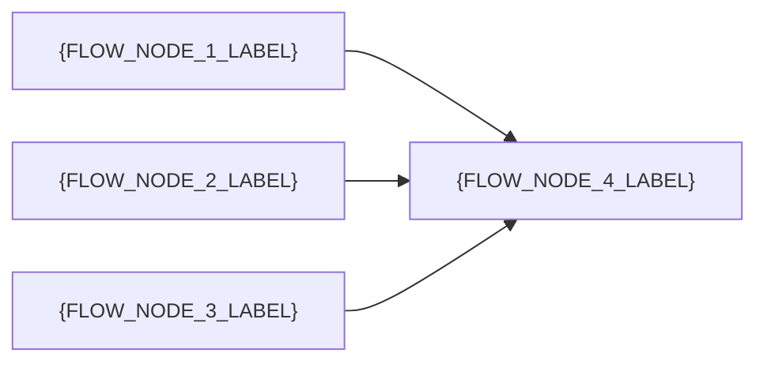
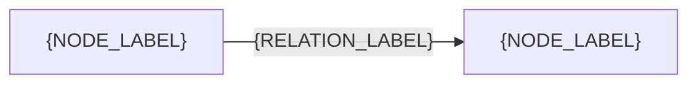

<!--
IOF DOMAIN ONTOLOGY README TEMPLATE
Generalized from ontology/core/README.md and ontology/biopharma/README.md.

PURPOSE
This file is a prompt/skeleton to give to an LLM (or a human author) to
generate a README.md for a new or existing IOF reference/domain ontology
(e.g. supplychain, productionplanning, maintenance, certification,
productservicesystem). It captures the section structure, table shapes,
and diagram patterns shared by the Core README and the Biopharmaceutical
Manufacturing (BMIC) README, with the domain-specific content replaced by
placeholders.

HOW TO USE THIS TEMPLATE
1. Fill in every {PLACEHOLDER}. Placeholders are ALL_CAPS inside curly
   braces. Do not leave a placeholder unresolved in the output README.
2. Each <!-- INSTRUCTION: ... --> comment tells the author/LLM what
   belongs in the section that follows it. Remove all INSTRUCTION
   comments from the final rendered README; they are authoring guidance
   only, not README content.
3. A section marked "(OPTIONAL)" SHOULD be included only if it applies
   to this ontology; omit it entirely otherwise rather than leaving it
   empty or writing "N/A".
4. Preserve the section order below. It reflects the structure readers
   of other IOF READMEs already expect.
5. Write in precise, declarative, standards-appropriate language.
   State what the ontology does and represents; avoid marketing tone,
   hedging, or unexplained jargon. Define every acronym on first use.
   Use RFC 2119-style keywords (MUST/SHOULD/MAY) only where the text is
   genuinely prescribing conformance behavior (e.g. IRI or versioning
   rules) -- not in ordinary descriptive prose.
6. Every mermaid diagram MUST be re-derived from this ontology's actual
   concepts and relations, not copied from Core or BMIC. Keep diagrams
   small (roughly 4-8 nodes) and label edges with the actual object
   property used (e.g. "prescribes", "has part", "inheres in").
7. Every table row MUST correspond to a real file or construct in this
   ontology's directory. Do not invent modules, mappings, or resources.
8. Cross-check every claim against the ontology's RDF/OWL source files
   and their iof-av:maturity, owl:versionIRI, and import declarations.
   Where this document and the RDF disagree, the RDF is authoritative
   and this document MUST be corrected.
-->

# {ONTOLOGY_TITLE}

<!-- INSTRUCTION: Optional badge/logo block. Include only if the
repository already uses image badges (as core/README.md does); omit
entirely for a plain-text header (as biopharma/README.md does). -->

**{ONE_LINE_TAGLINE}**

<!-- INSTRUCTION: One introductory paragraph (3-5 sentences). State:
(a) what kind of ontology this is (mid-level hub vs. domain/reference
ontology extending Core), (b) what real-world things it gives shared
meaning to (list the top 6-10 subject-matter nouns, e.g. "materials,
equipment, recipes, ..."), and (c) why that shared meaning matters --
typically "so data from different systems can be connected, compared,
queried, traced, and reused." -->

{ONTOLOGY_NAME} is {ONTOLOGY_TYPE_AND_SCOPE_STATEMENT}.

<!-- INSTRUCTION: Second paragraph. State where this ontology sits in
the IOF hub-and-spoke architecture (what it imports/extends -- BFO
alone, or BFO + IOF Core, or BFO + IOF Core + another reference
ontology), and what it supports without replacing (name the systems of
record it is meant to interoperate with, not substitute for). -->

{ONTOLOGY_NAME} is part of the broader Industrial Ontologies Foundry
(IOF). {RELATIONSHIP_TO_PARENT_ONTOLOGIES}. It supports semantic
interoperability across {LIST_OF_SYSTEM_TYPES}; it does not replace
them.

{ONTOLOGY_NAME} resources can be used directly, mapped to, or extended
for application-specific and organization-specific needs.

## Table of Contents

<!-- INSTRUCTION: Regenerate this list from the actual headings used
below after all optional sections are resolved. Keep anchor links in
GitHub's auto-slug format. -->

- [What {ONTOLOGY_SHORT_NAME} helps with](#what-ontology_short_name-helps-with)
- [Getting started](#getting-started)
- [Putting {ONTOLOGY_SHORT_NAME} to use](#putting-ontology_short_name-to-use)
- [What {ONTOLOGY_SHORT_NAME} represents](#what-ontology_short_name-represents)
  - [Important modeling distinctions](#important-modeling-distinctions)
- [Released {ONTOLOGY_SHORT_NAME}](#released-ontology_short_name)
- [Provisional extensions](#provisional-extensions) <!-- omit if none -->
- [Development, review, and validation](#development-review-and-validation)
- [Technical foundations and conventions](#technical-foundations-and-conventions)
- [IRI, versioning, maturity, and deprecation](#iri-versioning-maturity-and-deprecation)
- [Program and release history](#program-and-release-history)
- [Contributing](#contributing)
- [License](#license)

## What {ONTOLOGY_SHORT_NAME} helps with

<!-- INSTRUCTION: 5-8 bullets, each starting with a gerund or question,
describing concrete tasks the ontology supports (connecting data
across systems, tracing X, relating Y to Z, representing distinctions
that a single generic field would collapse, integrating data across
named system categories). Follow with one paragraph on how the
ontology has been validated (competency questions, representative
data) and where fuller validation evidence lives (public repo vs.
member-only channel), if applicable. -->

{ONTOLOGY_SHORT_NAME} supports work such as:

- {USE_CASE_1};
- {USE_CASE_2};
- {USE_CASE_3};
- {USE_CASE_4};
- {USE_CASE_5}.

{VALIDATION_STATEMENT}

## Getting started

### Browse online

The [IOF Ontology Browser](https://spec.industrialontologies.org/portal/)
provides a zero-install way to browse {ONTOLOGY_SHORT_NAME} and the
broader IOF ontology suite.

Use it to inspect labels, definitions, annotations, hierarchy, module
membership, and reused IOF concepts.

Browse the ontology: <https://spec.industrialontologies.org/portal/>

The browser may not immediately reflect unreleased repository changes.
The RDF files and their version and maturity metadata remain the
source of truth for this repository.

<!-- INSTRUCTION (OPTIONAL): Include a Public / Member-access resources
table only if this ontology's program (like BMIC/NIIMBL) has a tiered
access model with member-only companion resources. Omit entirely if
all resources are public, as with Core. -->

### Public and member-access resources

| Access | Resources |
|---|---|
| Public / open | {PUBLIC_RESOURCES_LIST} |
| Member-access companion resources | {MEMBER_RESOURCES_LIST} |

Member-access companion resources are separate from the public
ontology modules and do not change the Released or Provisional
maturity of those ontologies.

<!-- INSTRUCTION: Collapsible acronym table. Include only if the
README uses more than ~8 domain acronyms; alphabetize by acronym;
always expand BFO, IOF, OWL, RDF, SPARQL, SHACL plus every
domain-specific acronym used anywhere in the document. -->

<details>
<summary><strong>Acronyms used in this README</strong></summary>

| Acronym | Meaning |
|---|---|
| BFO | Basic Formal Ontology |
| IOF | Industrial Ontologies Foundry |
| OWL | Web Ontology Language |
| RDF | Resource Description Framework |
| SHACL | Shapes Constraint Language |
| SME | Subject-matter expert |
| SPARQL | SPARQL Protocol and RDF Query Language |
| {DOMAIN_ACRONYM_1} | {DOMAIN_ACRONYM_1_MEANING} |

</details>

<details>
<summary><strong>Developer and ontology quick start</strong></summary>

#### Choose an entry point

<!-- INSTRUCTION: List every top-level aggregate/entry-point RDF file
that actually exists in this ontology's directory. At minimum this is
usually a direct-import file (Core.rdf-style) or a Prod aggregate, plus
a Dev aggregate, plus individual modules, plus the import-resolution
catalog. -->

| File | Use |
|---|---|
| [`{PROD_AGGREGATE_FILE}`](./{PROD_AGGREGATE_FILE}) | {PROD_AGGREGATE_DESCRIPTION} |
| [`{DEV_AGGREGATE_FILE}`](./{DEV_AGGREGATE_FILE}) | {DEV_AGGREGATE_DESCRIPTION} |
| Individual `.rdf` modules | Import only the semantic areas required by an application |
| [`catalog-v001.xml`](./catalog-v001.xml) | Local import resolution for ontology tooling |

Ontology maturity and aggregate membership are separate. A Released
optional utility does not become Provisional because it is included in
`{DEV_AGGREGATE_FILE}`.

```bash
git clone https://github.com/iofoundry/ontology.git
cd ontology/{DOMAIN_DIRECTORY_NAME}
```

Start with `{PROD_AGGREGATE_FILE}` for Released {ONTOLOGY_SHORT_NAME}.
Use `{DEV_AGGREGATE_FILE}` when Provisional modules {OPTIONAL_UTILITY_CLAUSE}
are required.

For Protégé and other OWL tooling, a full repository checkout is
recommended so `catalog-v001.xml` can resolve sibling IOF and cached
dependencies. For RDF stores or application pipelines, load the
aggregate or selected modules with the import closure required by the
application and configure reasoning explicitly.

</details>

## Putting {ONTOLOGY_SHORT_NAME} to use

<!-- INSTRUCTION: One intro sentence, then a bulleted list of usage
patterns in **bold-label:** form. Keep the pattern names generic
(Data mapping, Knowledge graphs, SPARQL and comparative analysis,
Reasoning, Validation, standards/protocol integration, Search and
retrieval) but write the description for this domain. Follow with two
short paragraphs: (1) that the ontology uses standard RDF/OWL/SPARQL
and is not tied to a particular triple store, with reasoning/entailment
behavior varying by product; (2) an explicit non-prescription
statement -- name the categories of technology/platform/protocol this
ontology does NOT mandate. -->

{ONTOLOGY_SHORT_NAME} can be mapped to existing data, used to build
knowledge graphs, queried across systems, and combined with validation
and reasoning tools. Common patterns include:

- **Data mapping:** {DATA_MAPPING_DESCRIPTION}
- **Knowledge graphs:** {KNOWLEDGE_GRAPH_DESCRIPTION}
- **SPARQL and comparative analysis:** {SPARQL_DESCRIPTION}
- **Reasoning:** {REASONING_DESCRIPTION}
- **Validation:** {VALIDATION_DESCRIPTION}
- **{DOMAIN_STANDARDS_INTEGRATION_LABEL}:** {DOMAIN_STANDARDS_INTEGRATION_DESCRIPTION}
- **Search and retrieval:** {SEARCH_RETRIEVAL_DESCRIPTION}

{ONTOLOGY_SHORT_NAME} uses standard RDF/OWL and SPARQL and is not tied
to a particular triple store. Reasoning and entailment behavior vary by
product and should be tested for the selected platform.

{ONTOLOGY_SHORT_NAME} does not prescribe a particular
{LIST_OF_NON_PRESCRIBED_TECHNOLOGY_CATEGORIES}.

## What {ONTOLOGY_SHORT_NAME} represents

<!-- INSTRUCTION: One paragraph describing where the domain's
information is fragmented today (list the source systems/documents)
and how the same real-world thing ends up named/structured
differently across them. One paragraph introducing the shared-meaning
value proposition, followed by a bulleted list of 4-6 competency
questions phrased as real questions a user would ask across connected
data. Close with one sentence on how statistical/other analysis is
performed by applications, not the ontology. -->

{DOMAIN_INFORMATION_FRAGMENTATION_PARAGRAPH}

{ONTOLOGY_SHORT_NAME} provides shared meaning across that information
so applications can connect the data and ask questions such as:

- {COMPETENCY_QUESTION_1}
- {COMPETENCY_QUESTION_2}
- {COMPETENCY_QUESTION_3}
- {COMPETENCY_QUESTION_4}

{ONTOLOGY_SHORT_NAME} provides the shared meanings and relationships
needed for those questions. {ANALYSIS_DISCLAIMER_SENTENCE}

<!-- INSTRUCTION: One mermaid flowchart (LR) summarizing the domain's
primary information flow in 4-6 boxes, mirroring the "what went
in / what was prescribed / what happened / what was observed" shape
used by BMIC, adapted to this domain's actual upstream inputs,
prescriptive artifacts, execution, and observed outputs. Keep node
text short with a bold lead phrase and 1-3 supporting terms. -->



{ADDITIONAL_COVERAGE_SENTENCE}

### Important modeling distinctions

<!-- INSTRUCTION: This is the highest-value, most domain-specific
section. Include one `####`-level subsection per genuinely important
distinction this ontology makes -- typically 3-6 of them. Core and
BMIC each used a mix of: a short explanatory paragraph, a table, and a
mermaid diagram (flowchart TB/LR, or a text-block fallback) per
distinction. Do not force every subsection into the same shape; use
whichever of {paragraph, table, mermaid diagram, blockquote pull-quote}
best shows the distinction. Name the actual classes/relations (in
`code formatting`) this ontology uses. If a subsection's value is not
obvious, add a closing "**Value:**" sentence explaining what it buys
implementers (Core's pattern) -- optional but recommended for every
subsection describing a functions/values/classification pattern. -->

#### {MODELING_DISTINCTION_1_TITLE}

{MODELING_DISTINCTION_1_EXPLANATION}



<!-- Repeat #### subsections for each additional distinction. -->

## Released {ONTOLOGY_SHORT_NAME}

<!-- INSTRUCTION: One sentence stating the count of Released modules
(and any Released optional utility ontologies, counted separately).
Then a single table: one row per Released `.rdf` module file, with a
one-line description of its main coverage pulled from the module's own
annotations, not invented. Close with one sentence on what the
modules connect together as a whole. -->

Released {ONTOLOGY_SHORT_NAME} currently comprises {N} Released domain
modules{OPTIONAL_UTILITY_COUNT_CLAUSE}.

### Released modules

| Module | Main coverage |
|---|---|
| [`{MODULE_1_FILE}`](./{MODULE_1_FILE}) | {MODULE_1_COVERAGE} |
| [`{MODULE_2_FILE}`](./{MODULE_2_FILE}) | {MODULE_2_COVERAGE} |

Together, these modules connect {LIST_OF_CONNECTED_SUBJECT_AREAS}.

## Provisional extensions

<!-- INSTRUCTION (OPTIONAL): Omit this whole section if the ontology
has no Provisional-maturity modules. If it does, name the dev
aggregate that includes them, then a table (Provisional module ->
current scope), then one paragraph on what the Provisional modules
extend Released content into, explicitly stating that inclusion in the
dev aggregate does not imply Released maturity. -->

[`{DEV_AGGREGATE_FILE}`](./{DEV_AGGREGATE_FILE}) adds {N} modules whose
maturity is explicitly Provisional.

| Provisional module | Current scope |
|---|---|
| [`{PROVISIONAL_MODULE_1_FILE}`](./{PROVISIONAL_MODULE_1_FILE}) | {PROVISIONAL_MODULE_1_SCOPE} |

These modules extend Released {ONTOLOGY_SHORT_NAME} into
{EXTENSION_AREAS}. Inclusion in the development aggregate does not
imply Released maturity.

### Current focus and next phase

<!-- INSTRUCTION (OPTIONAL): One or two sentences on planned future
scope, explicitly labeled as a roadmap statement rather than Released
scope. Omit if there is no public roadmap to disclose. -->

{ROADMAP_STATEMENT} This is a roadmap statement, not Released scope.

## Development, review, and validation

<!-- INSTRUCTION: One sentence naming the contributor roles (domain
SMEs, ontologists, implementation practitioners, standards
contributors). Then a bulleted **label:** list of quality checks --
keep SME review, ontology review, reasoner consistency checks,
competency-question testing, automated hygiene tests, implementation
feedback, and provenance/maturity metadata unless this ontology's
process genuinely omits one of them. Close with one sentence stating
the review is more than "it parses / the reasoner is happy" -- name
the multiple perspectives it is reviewed from. -->

{ONTOLOGY_SHORT_NAME} is developed collaboratively by
{CONTRIBUTOR_ROLES_LIST}.

Quality checks include:

- **SME review:** terminology, definitions, examples, and domain distinctions;
- **ontology review:** conceptual coherence, BFO/IOF alignment, axiomatization, relation use, and module design;
- **{REASONER_NAME} reasoner checks:** logical consistency of OWL import closures;
- **competency-question testing:** whether {ONTOLOGY_SHORT_NAME} supports representative {DOMAIN_ADJECTIVE} information needs;
- **automated ontology hygiene tests:** repository-level annotation, metadata, and maintenance checks;
- **implementation feedback:** lessons from knowledge graphs, mappings, and applications;
- **provenance and maturity metadata:** explicit source, adaptation, and Released/Provisional status.

The goal is not merely for the ontology to parse or for a reasoner to
report consistency. {ONTOLOGY_SHORT_NAME} is reviewed from
{REVIEW_PERSPECTIVES_LIST} perspectives together.

## Technical foundations and conventions

### Relationship to the broader IOF ontology suite

{ONTOLOGY_SHORT_NAME} is {POSITIONING_STATEMENT_RELATIVE_TO_IOF}.

```text
Basic Formal Ontology (BFO)
        ↓
IOF Core and reference ontologies
        ↓
shared industry-agnostic concepts and relations
        ↓
{ONTOLOGY_SHORT_NAME} {DOMAIN_ADJECTIVE} content
        ↓
application ontologies, enterprise extensions, mappings, and data products
```

BFO supplies the upper-level foundation. IOF Core imports BFO 2020, and
{ONTOLOGY_SHORT_NAME} inherits that foundation through IOF. IOF Core
and reference ontologies provide concepts and relations that can be
reused across industrial domains.

Using the same foundation does not automatically make every model
interoperable, but it provides common concepts and relations for
mappings and cross-domain links. This matters when {DOMAIN_ADJECTIVE}
information must connect with {LIST_OF_ADJACENT_ENTERPRISE_FUNCTIONS}.

The goal is not one enormous ontology. Each domain can keep the detail
it needs while sharing common IOF concepts where appropriate.
{ONTOLOGY_SHORT_NAME}-originated concepts that prove useful beyond
{DOMAIN_NAME_LOWER} can be considered for migration into shared IOF
reference or mid-level ontologies.

### External ontology, standards, and guidance provenance

<!-- INSTRUCTION: Only list ontologies/standards actually reused or
cited by this ontology's annotations (check adaptedFrom / directSource
/ excerptedFrom annotations in the RDF before writing this). -->

{ONTOLOGY_SHORT_NAME} reuses established ontology work and cites
recognized standards, regulatory guidance, and technical sources where
they materially inform meaning.

Examples include:

- **{EXTERNAL_ONTOLOGY_1}** for {EXTERNAL_ONTOLOGY_1_USE};
- **{STANDARD_1}** for {STANDARD_1_USE}.

{REGULATORY_PROVENANCE_SENTENCE, if applicable}

Exact source URLs are recorded on relevant ontology terms.
`adaptedFrom` records conceptual or definitional reuse. It does not by
itself assert `owl:equivalentClass`, `owl:equivalentProperty`,
identity with the source term, or formal conformance. Stronger
mappings are asserted only where explicitly defined.

### Definitions, logic, and annotation policy

{ONTOLOGY_SHORT_NAME} follows the broader
[IOF Annotation Property Guide](https://oagi.atlassian.net/wiki/spaces/IOF/pages/6750797825/IOF+Annotation+Property+Guide+V2.5)
rather than defining a separate annotation scheme. Every
{ONTOLOGY_SHORT_NAME} class and property has a human-readable label,
natural-language definition, and examples. Every
{ONTOLOGY_SHORT_NAME} class also has OWL axiomatization, a
first-order-logic (FOL) definition or axiom, and a corresponding
semi-formal natural-language statement.

| Layer / annotation | {ONTOLOGY_SHORT_NAME} practice |
|---|---|
| Label | Provided for every class and property as the preferred human-readable term |
| Natural-language definition | Provided for every class and property and states the intended meaning |
| Examples | Provided for every class and property to illustrate intended use |
| OWL axioms | Provide the machine-processable representation used for reasoning, classification, and consistency checking |
| First-order-logic (FOL) definition or axiom | Provided for every class; captures the intended formal meaning represented in OWL and, where needed, augments it with conditions that OWL cannot directly express |
| Semi-formal natural-language definition or axiom | Provided for every class as a readable counterpart to the FOL formalization |
| Explanatory notes *(as applicable)* | Clarify important distinctions, modeling rationale, or interpretation that is not appropriate to place in the definition itself |
| Usage notes *(as applicable)* | Provide guidance on how a construct should or should not be used in modeling or implementation |
| Counterexamples *(as applicable)* | Clarify important exclusions or commonly confused cases |
| Synonyms, acronyms, and abbreviations *(as applicable)* | Record alternative terminology used by domain experts, standards, systems, or literature |
| Source and provenance annotations *(as applicable)* | Record sources and conceptual or definitional adaptation, including `adaptedFrom` where appropriate |

The OWL and FOL layers are intended to be consistent with one another
rather than alternative models of the same term. FOL provides the
fuller formal statement where the intended meaning goes beyond what
can be captured directly in OWL, while the semi-formal annotation
makes that same statement easier to review.

FOL annotations are not executed by standard OWL reasoners.

### Querying and validating {ONTOLOGY_SHORT_NAME} data

{ONTOLOGY_SHORT_NAME} data can be queried with SPARQL using the
ontology's classes and relations. OWL reasoning can provide additional
classifications where {ONTOLOGY_SHORT_NAME} defines them, while SHACL
or application-level rules can be used for closed-world validation
requirements. {OPTIONAL_SHACL_RESOURCE_AVAILABILITY_SENTENCE}

### Units and QUDT

<!-- INSTRUCTION (OPTIONAL): Include only if this ontology represents
quantitative values/measurements. -->

{ONTOLOGY_SHORT_NAME} uses QUDT (Quantities, Units, Dimensions and Data
Types) for unit representation in accordance with IOF guidance.

[IOF Guideline for Using QUDT with IOF Ontologies](https://oagi.atlassian.net/wiki/spaces/IOF/pages/4679696397/Guideline+for+Using+QUDT+if+were+to+use+with+IOF+Ontologies)

### Optional reasoning utilities

<!-- INSTRUCTION (OPTIONAL): Include only if this ontology ships
Released optional utility ontologies (classification utilities,
property-chain addenda, SWRL addenda) analogous to BMIC's recipe
occurrence-classification utilities or Core's Allen-interval addenda.
State clearly that they are Released but excluded from the default
Prod import closure because they are optional, and what including them
in the Dev aggregate does and does not imply. -->

{ONTOLOGY_SHORT_NAME} includes {N} Released optional reasoning
utilities:

- [`{UTILITY_1_FILE}`](./{UTILITY_1_FILE}), which {UTILITY_1_DESCRIPTION};

These utilities are Released but intentionally outside the default
`{PROD_AGGREGATE_FILE}` import closure because they are optional
reasoning packages. `{DEV_AGGREGATE_FILE}` includes them for
convenience; this does not make them Provisional.

## IRI, versioning, maturity, and deprecation

{ONTOLOGY_SHORT_NAME} construct IRIs are decoupled from ontology-module
IRIs.

Constructs use:

```text
https://spec.industrialontologies.org/ontology/construct/[Term]
```

For example:

```text
https://spec.industrialontologies.org/ontology/construct/{EXAMPLE_CONSTRUCT_NAME}
```

{DOMAIN_NAME_LOWER} ontology modules use:

```text
https://spec.industrialontologies.org/ontology/{DOMAIN_DIRECTORY_NAME}/[Ontology]/
```

`rdfs:isDefinedBy` identifies the ontology module in which a construct
is currently defined. This allows module architecture to evolve
without requiring the construct IRI to change.

Individual ontologies carry `owl:versionIRI` metadata. Applications
that need the exact ontology version should rely on ontology metadata
rather than a README date or branch name.

Ontology maturity is recorded through `iof-av:maturity`, including
`iof-ind:Released` and `iof-ind:Provisional`.

Instance data should reference {ONTOLOGY_SHORT_NAME}/IOF construct
IRIs, not ontology-module version IRIs. When upgrading ontology
versions, applications should review release changes and rerun
reasoning, mappings, competency queries, and validation checks.
Provisional content should be expected to change more readily than
Released content.

Retired or moved constructs can be marked with `owl:deprecated true`
and migration annotations such as `iof-av:replacedBy`.
{OPTIONAL_CURRENT_DEPRECATION_USAGE_SENTENCE}

## Program and release history

<!-- INSTRUCTION: One paragraph on the ontology's origin (sponsoring
program, working group, when development began) and how it reached
IOF. One paragraph per notable public release, in chronological order,
stating what scope each release covered. Close with a "Useful
resources" bulleted list of links (Ontology Browser, program page, any
release-announcement pages, applicable guideline docs). -->

{PROGRAM_ORIGIN_PARAGRAPH}

{RELEASE_HISTORY_PARAGRAPH(S)}

Useful resources:

- **[IOF Ontology Browser](https://spec.industrialontologies.org/portal/)**: browse {ONTOLOGY_SHORT_NAME} and the wider IOF ontology suite.
- **[{PROGRAM_PAGE_NAME}]({PROGRAM_PAGE_URL})**: program, working groups, roadmap, and participation information.
- [IOF Annotation Property Guide](https://oagi.atlassian.net/wiki/spaces/IOF/pages/6750797825/IOF+Annotation+Property+Guide+V2.5): IOF requirements and guidance for ontology and construct annotations.

The RDF files, their import declarations, `owl:versionIRI` values, and
`iof-av:maturity` annotations remain the source of truth for
{ONTOLOGY_SHORT_NAME}'s current technical scope and maturity.

## Contributing

{ONTOLOGY_SHORT_NAME} continues to evolve through
{WORKING_GROUP_NAME_OR_PROCESS} and the IOF development and governance
process.

Contributions may include domain review, competency questions,
implementation feedback, definitions, ontology patterns, data
mappings, examples and counterexamples, validation results,
application extensions, or proposals to move broadly applicable
constructs into shared IOF layers.

Current development items: <{ISSUE_TRACKER_URL}>

Program and participation information: <{PROGRAM_PAGE_URL}>

### Citing {ONTOLOGY_SHORT_NAME}

When citing {ONTOLOGY_SHORT_NAME} in an implementation, report, or
publication, identify {ONTOLOGY_FULL_NAME_WITH_ACRONYM} and the exact
ontology `owl:versionIRI` or repository release used.
{OPTIONAL_CITABLE_ANNOUNCEMENT_SENTENCE}

## License

{ONTOLOGY_SHORT_NAME}-authored ontology files are distributed under
the MIT License as part of the IOF ontology repository. Imported,
cached, or reused third-party ontology resources remain subject to
their respective licenses.

<https://opensource.org/licenses/MIT>
